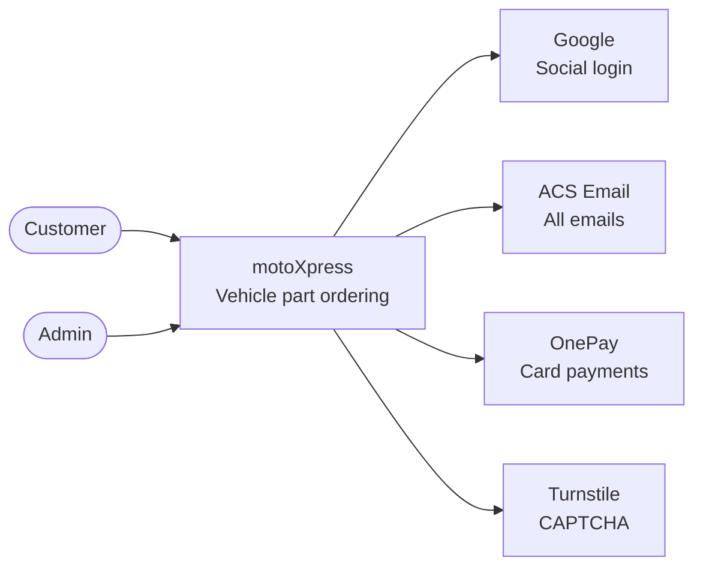

# Context diagram (C4 level 1)

This is the highest-level view. It shows motoXpress as one box, the people
who use it, and the outside systems it depends on. It hides all internal
services on purpose.

## Outside systems

| System | What it is for | Which service calls it |
|---|---|---|
| Google | Login with Google | user-service |
| ACS Email | Password reset, order emails, suggestion emails | notification-service |
| OnePay | Card payments (sandbox) | payment-service |

## Not outside systems

PostgreSQL, RabbitMQ, and the LightFM recommendation engine are NOT outside
systems. We build and run them, so they live inside motoXpress. A library
(like LightFM) is code inside a service, not a separate system. These
appear in the container diagram (level 2), not here.

## How to tell inside from outside

Ask: who builds and runs it? If someone else runs it and we only call it,
it is outside (Google, ACS Email, OnePay). If we build and run it, it is
inside (our services, PostgreSQL, RabbitMQ, LightFM).
