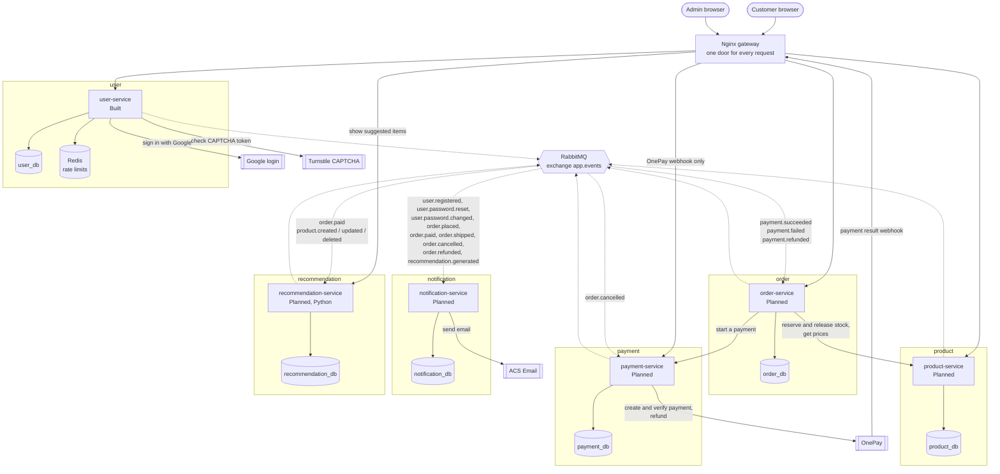

# Container diagram (C4 level 2)

- show how services communicae with each other

## How to read it

- Solid arrow = HTTP. The caller sends a request and **waits** for the answer.
- Dotted arrow = event. The sender does **not** wait. Every event goes into RabbitMQ first,
  then RabbitMQ hands it to the services that listen.
- Labels on the dotted arrows are the real event names from [06-event-contracts.md](06-event-contracts.md).

This picture is bigger than the others. A container diagram must show every running
part once, so it cannot be split.

## What each container does

| Container | Job | Domain-free? | Status |
|---|---|---|---|
| **Nginx gateway** | One entry point. Sends each path to the right service. No business logic. | — | Config written |
| **user-service** | Sign-up, login, tokens, accounts, admin roles | **Yes** | Built |
| **product-service** | Products, categories, vehicle fit, stock | No | Planned |
| **order-service** | Checkout, orders, order status | No | Planned |
| **payment-service** | Talks to OnePay; records payments and refunds; cash on delivery | **Yes** | Planned |
| **notification-service** | Sends email (and push, later) from templates | **Yes** | Planned |
| **recommendation-service** | Suggests items (SQL rules first, LightFM later) | **Yes** | Planned |
| **RabbitMQ** | Carries every event from publisher to listeners | — | In docker-compose |
| **Redis** | Rate-limit counters for user-service | — | In docker-compose |
| **PostgreSQL** | One server, one database and one DB user per service (decision 6) | — | In docker-compose |

**Domain-free** means the service never uses shop words (order, product, cart...) in its code.
It could be reused in another project by changing only `application.yaml`.

Push messages need an outside push provider. It is not chosen yet, so it is not drawn.

## Where Nginx sends each path

The customer site (`http://localhost`) and the admin site (`http://localhost:8000`)
have the same API routes. Only the `/` route is different.

| Path starts with | Goes to | Port |
|---|---|---|
| `/api/v1/user/` | user-service | 8080 |
| `/oauth2/` and `/login/oauth2/` | user-service (Google login) | 8080 |
| `/api/v1/product/` | product-service | 8081 |
| `/api/v1/order/` | order-service | 8082 |
| `/api/v1/payment/` | payment-service | 8084 |
| `/api/v1/recommendation/` | recommendation-service | 8085 |
| `/` on port 80 | users-ui | 3000 |
| `/` on port 8000 | admin-ui | 3001 |

notification-service (8083) has **no** route. Nobody outside may call it.
Paths that start with `/internal/` are never routed either. Only other services call them.
Full list of endpoints: [09-api-map.md](09-api-map.md).

## Rules every service follows

| Rule | What it means |
|---|---|
| One error shape | Every error is the same JSON: `timestamp, status, code, message, path, refreshable, details`. user-service already does this (`ErrorResponse.java`). |
| Trace id | Nginx adds an `X-Request-Id` header. Each service writes it in every log line and passes it on when it calls another service. Then one request can be followed across all logs. |
| Check the login itself | The browser sends the `access_token` cookie to every service, because there is only one origin. Each service checks the token on its own. Plan: user-service signs with a private key, the others check with its public key (decision 3, Proposed). |
| Skip duplicate events | Every event has a `messageId`. A listener saves the ids it has handled and skips a repeat. |
| Own database only | Each service has its own database and DB user. It never reads another service's tables. |
| Health check | Each service has a health URL, so Docker and Kubernetes know it is alive. TODO: choose the tool. Spring Boot Actuator is the usual one for Java. |
