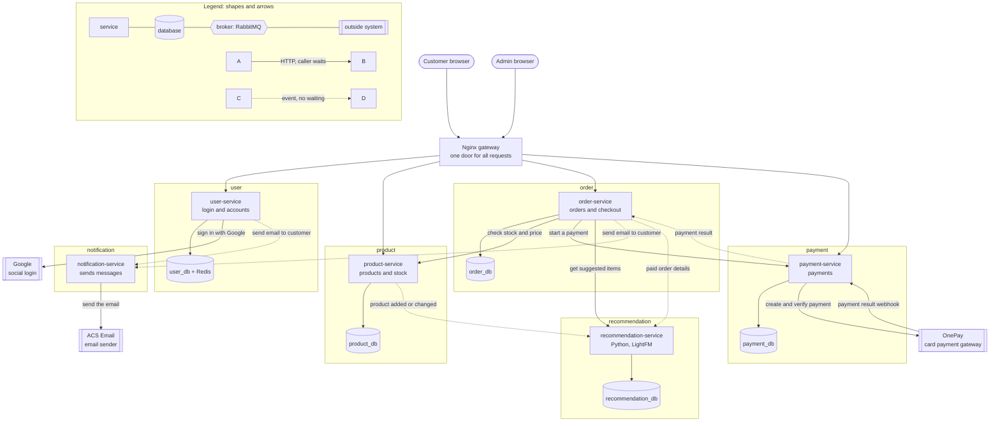

# Container diagram (C4 level 2)

This diagram opens the motoXpress system box from the context diagram.
It shows every separately running part: the gateway, the services, the
databases, and the outside systems.

Status: draft for review. Not final.

## How to read the arrows

- A solid arrow means HTTP. The caller sends a request and waits for the answer.
- A dotted arrow means an event. The sender does not wait for any answer.
- All events travel through RabbitMQ, our message broker. The broker box is not
  drawn, to keep the picture clear.
- Arrow labels use plain words. The exact event names used in the code are in
  the event legend below the diagram.

## Legend 1: what each running part does

| Service                    | Job                                                        | Domain-free? | Reason                                                                                             |
| -------------------------- | ---------------------------------------------------------- | ------------ | -------------------------------------------------------------------------------------------------- |
| **Nginx gateway**          | Single entry point; routes requests to the correct service | —            | Infrastructure component                                                                           |
| **user-service**           | Login, sign-up, tokens, user accounts                      | **Yes**      | Only handles accounts, authentication, roles, and tokens                                           |
| **product-service**        | Products, categories, stock, vehicle fit                   | **No**       | Product and vehicle-fit rules are core MotoXpress business logic                                   |
| **order-service**          | Checkout, orders, order status                             | **No**       | Checkout and order rules are core MotoXpress business logic                                        |
| **payment-service**        | Communicates with OnePay; records payments                 | **Yes**      | Handles amounts, payment references, and gateway communication without knowing what was purchased  |
| **notification-service**   | Sends email notifications                                  | **Yes**      | Only needs a message, recipient/address, and template information                                  |
| **recommendation-service** | Generates product recommendations                          | **Yes**      | Works with generic users, items, and interactions; recommendation logic is reusable across systems |

## Legend 2: what each event line means

The middle column is the real event name in the code. The picture uses the
plain words instead, so any reader can follow it.

| Plain words on the line | Event name in code | What it means |
|---|---|---|
| payment result | payment.succeeded / payment.failed | payment-service tells order-service if the card payment worked or not, so order-service can mark the order paid or unpaid. |
| send email to customer (from order) | notification.requested | order-service asks notification-service to email the customer, for example "your order is paid". |
| send email to customer (from user) | notification.requested | user-service asks notification-service to email the customer, for example a welcome email. |
| paid order details | interaction.recorded | order-service sends only successful, paid orders to recommendation-service, which stores them in its own table as purchase history. |
| product added or changed | item.changed | when a product is added or edited, product-service sends it to recommendation-service, which keeps its own small copy for making suggestions. |

