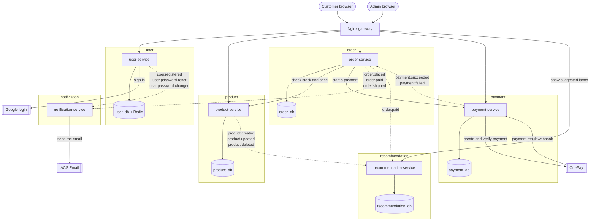

# Container diagram (C4 level 2)

This diagram opens the motoXpress system box from the context diagram.
It shows every separately running part: the gateway, the services, the
databases, and the outside systems.

Status: draft for review. Not final.

## How to read the arrows

- A solid arrow means HTTP. The caller sends a request and waits for the answer.
- A dotted arrow means an event. The sender does not wait for any answer.
- All events travel through RabbitMQ. Every event goes to one topic exchange
  called `app.events`. The broker box is not drawn, to keep the picture clear.
- Dotted arrow labels are the real event names.
- The queues and bindings for these events are in the event contract.

## What each service does

| Service | Job | Domain-free? |
|---|---|---|
| **Nginx gateway** | Single entry point; routes requests to the correct service | — |
| **user-service** | Login, sign-up, tokens, user accounts | **Yes** |
| **product-service** | Products, categories, stock, vehicle fit | **No** |
| **order-service** | Checkout, orders, order status | **No** |
| **payment-service** | Talks to OnePay; records payments | **Yes** |
| **notification-service** | Sends email and push | **Yes** |
| **recommendation-service** | Generates product recommendations (Python, LightFM) | **Yes** |

Push messages need an outside push provider. It is not chosen yet, so it is not drawn.