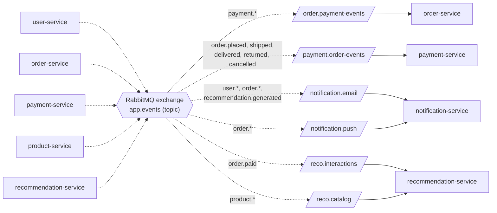

# motoXpress event contract (v1)

Status: agreed 2026-09-17.
Changed 2026-10-19: added `recommendation.generated` (decision 35).
Changed 2026-10-19: added `order.delivered`, `order.returned`, `payment.collected`, `payment.cancelled`
for cash on delivery with couriers (see `../mvp/07-events.md` for the MVP subset and body fields).

The single source of truth for RabbitMQ events in motoXpress. Every service must
follow this. For the "why" behind it, read `claude/rabbitmq-notes.md`.

---

## Broker setup

| Item | Value |
|---|---|
| Broker | RabbitMQ |
| Exchange | `app.events` |
| Exchange type | `topic` |
| Durable | yes |

Who declares what:

| Object | Declared by |
|---|---|
| exchange | publisher and consumer |
| queue | consumer only |
| binding | consumer only |

---

## Rules

1. An event name is a fact, past tense: `<thing>.<what happened>`, lowercase, dots.
2. Named in the publisher's own words. Never the listener's words.
3. Once bound to, a name is never renamed. Add a new event instead.
4. Every message carries a `messageId` header (a UUID), set by the publisher.

---

| Event name | Publisher | Published when |
|---|---|---|
| `user.registered` | user-service | a new account is created |
| `user.password.reset` | user-service | a password reset link is requested |
| `user.password.changed` | user-service | the password is changed |
| `order.placed` | order-service | an order is created |
| `order.paid` | order-service | the order is fully paid |
| `order.shipped` | order-service | the order leaves the warehouse |
| `order.delivered` | order-service | the courier delivered the parcel |
| `order.returned` | order-service | the courier brought the parcel back |
| `order.cancelled` | order-service | an order is cancelled (before it ships) |
| `order.refunded` | order-service | refund for the order is completed |
| `payment.succeeded` | payment-service | the money is confirmed (by the gateway, or by a courier receipt for cash on delivery) |
| `payment.collected` | payment-service | the courier collected the cash, not yet paid to us |
| `payment.cancelled` | payment-service | no money will come (order cancelled or parcel returned) |
| `payment.refunded` | payment-service | successfully refunded for the transaction-id|
| `payment.failed` | payment-service | the gateway rejects the payment |
| `product.created` | product-service | a product is added |
| `product.updated` | product-service | a product is edited |
| `product.deleted` | product-service | a product is removed |
| `recommendation.generated` | recommendation-service | the scheduled job has picked suggested items for one user |

---

## Subscriptions

| Consumer | Queue | Binding keys |
|---|---|---|
| order-service | `order.payment-events` | `payment.succeeded`, `payment.failed`, `payment.refunded`, `payment.collected`, `payment.cancelled` |
| payment-service | `payment.order-events` | `order.placed`, `order.shipped`, `order.delivered`, `order.returned`, `order.cancelled` |
| notification-service | `notification.email` | `user.registered`, `user.password.reset`, `user.password.changed`, `order.placed`, `order.paid`, `order.shipped`, `order.delivered`, `order.returned`, `order.cancelled`, `order.refunded`, `recommendation.generated` |
| notification-service | `notification.push` | `order.placed`, `order.paid`, `order.shipped`, `order.delivered`, `order.returned`, `order.cancelled`, `order.refunded` |
| recommendation-service | `reco.interactions` | `order.paid` |
| recommendation-service | `reco.catalog` | `product.*` |

---

## Picture: how an event reaches a queue

A publisher never sends to a queue. It sends to the exchange `app.events` with
the event name as the routing key. The exchange copies the message into every
queue whose binding key matches. One event can land in many queues.



The labels on the exchange arrows are short. The exact binding keys are in the
Subscriptions table above. For example, `notification.email` binds only the
`order.*` events listed there, not every `order.*` event.

Example: order-service publishes `order.paid`. The exchange puts one copy in
`notification.email`, one in `notification.push`, and one in `reco.interactions`.
Three services react. order-service does not know or care who listens.

---

## Message body

Small and generic. Ids and the few values consumers need, not whole entities.
Include what every consumer of that event needs.

Example — `order.paid`:

```json
{
  "userId":  "42",
  "email":   "nimal@example.com",
  "name":    "Nimal Perera",
  "orderNo": "MX-10231",
  "total":   "12500.00"
}
```
