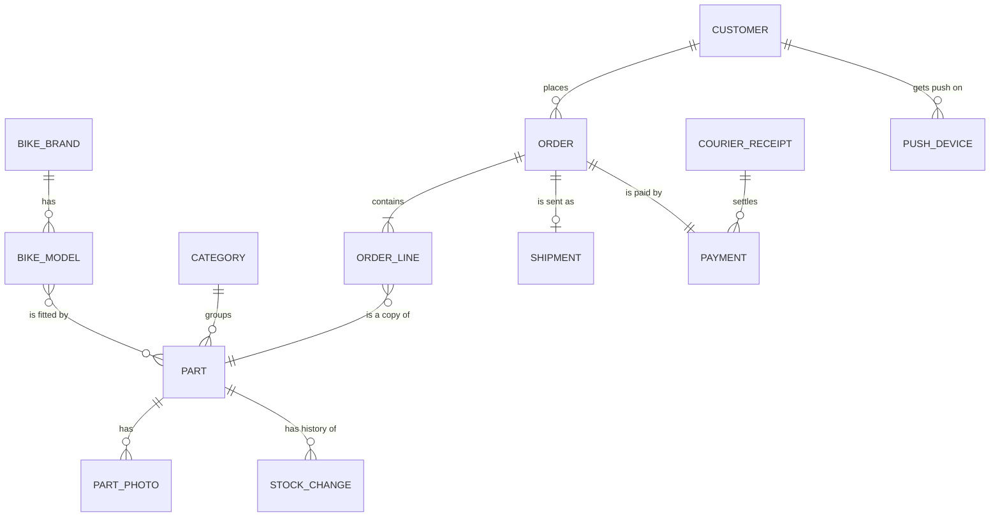

# Domain model (MVP)

The business words and how they connect. Not the database yet: that is
[08-data-model.md](08-data-model.md).

Line ends: `||` exactly one, `o|` zero or one, `|{` one or more, `o{` zero or more.

## Word list

| Word | Meaning | Example |
|---|---|---|
| Bike brand | Company that made the bike | Honda |
| Bike model | One bike type of a brand | XR 250 |
| Category | A group of parts | Chains and Sprockets |
| Part | One item we sell (`Product` in code) | 123HG Sprocket |
| Fitment | "This part fits this bike model" | 123HG fits XR 250 |
| Stock change | One change of stock with a reason | +20 "new delivery" |
| Order | One purchase | MX-10238 |
| Order line | One part in an order, with the price at that time | 2 × 123HG |
| Shipment | The parcel given to a courier | Courier A, WB55310 |
| Tracking number | The courier's id for the parcel | WB55310 |
| Payment | The money for one order | PAY-5018, cash on delivery |
| Courier receipt | The courier's payout to the shop, listing the parcels it covers | R-41, 11,950.00 received |
| Push device | One browser where the customer allowed push | Chrome on Nimal's phone |

## Who owns what

| Words | Owner | Others keep |
|---|---|---|
| Customer, admin, roles | user-service | order-service: user id + copy of name and email |
| Bike brand, bike model, category, part, fitment, photo, stock | product-service | order-service: copy of part number, name, price per line |
| Order, order line, **shipment** | order-service | payment-service: order number (as `reference`), courier and tracking number |
| Payment, courier receipt | payment-service | order-service: copy of the payment status |
| Push device, sent notifications | notification-service | nobody |

A service never reads another service's tables (decision 2). It keeps the few values it needs,
and events keep those copies up to date.
