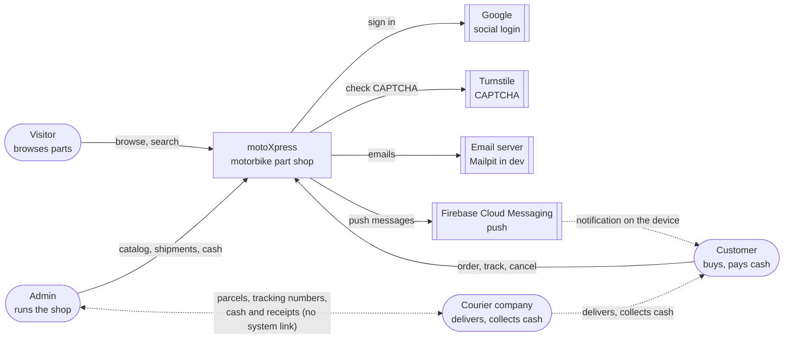

# Context diagram (C4 level 1) — MVP

motoXpress as one box, the people around it, and the outside systems it calls.

## Outside systems

| System | Used for | Called by |
|---|---|---|
| Google | "Continue with Google" | user-service (built) |
| Turnstile | CAPTCHA on register and forgot password | user-service (built) |
| Email server | All emails. Mailpit (a fake inbox) in dev. | notification-service |
| Firebase Cloud Messaging | Push messages to the customer's browser | notification-service |

## The courier is outside, and not connected

In the MVP the courier company has **no link** to our system. The admin talks to the courier
and types what they learn into the admin site: tracking numbers, delivered or returned, and
courier receipts. A courier API can replace the typing later (decision M6).

## Inside, not outside

PostgreSQL, Redis, RabbitMQ and Nginx are inside motoXpress: we run them.
See the [container diagram](04-container-diagram.md).
