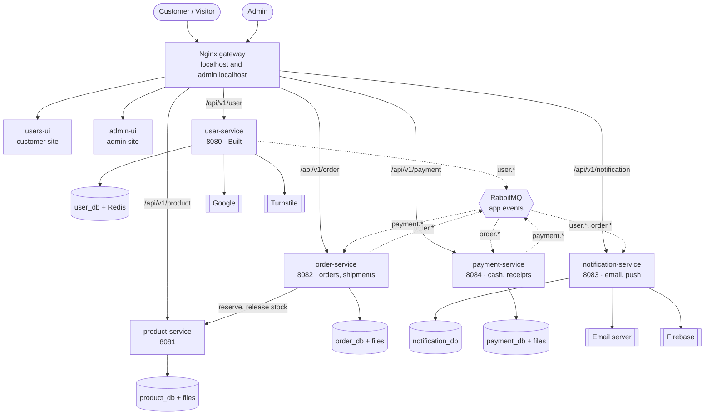

# Container diagram (C4 level 2) — MVP

A **container** is anything that runs on its own: a UI, a service, a database, the gateway,
the broker. (A C4 word; it does not mean a Docker container.)

- Solid arrow = HTTP. The caller waits.
- Dotted arrow = event through RabbitMQ. The sender does not wait.
- Event names come from [07-events.md](07-events.md).

The UIs are only files. The browser downloads them, then calls `/api/v1/...` on the **same**
host name. So each site is one origin: no CORS, and the login cookie goes along by itself.

## What each container does

| Container | Job | Its data | Status |
|---|---|---|---|
| Nginx | One door. Sends each host and path to the right place. | — | Config written, needs MVP update |
| users-ui | Customer site: browse, cart, checkout, my orders, push permission | Cart in the browser | Auth pages built |
| admin-ui | Admin site: catalog, stock, orders, shipments, payments, courier receipts, users | — | Planned |
| user-service | Accounts, login, tokens, roles, admin user tools | user_db; Redis for rate limits | Built |
| product-service | Brands, bike models, categories, parts, fitment, photos, stock | product_db; part photos | Planned |
| order-service | Checkout, orders, **shipments**, copy of payment status | order_db; pickup receipt photos | Planned |
| payment-service | Cash-on-delivery payments, **courier receipts** | payment_db; receipt PDFs | Planned |
| notification-service | Email and push from events; saves browsers that allowed push | notification_db | Planned |
| RabbitMQ | Carries events | — | In docker-compose |

## Who calls whom

| Caller | Callee | How | Why |
|---|---|---|---|
| Browser | user, product, order, notification, payment | HTTP through Nginx | Customer and admin actions (payment: admin pages only) |
| order-service | product-service | HTTP, internal path | Reserve and release stock, get real prices |
| Any service | notification-service | **Events only** | Emails and push are slow work |
| order-service ↔ payment-service | each other | **Events only** | Payment created on `order.placed`; status copied back with `payment.*` |
| product-service | anyone | — | Calls nobody, publishes nothing in the MVP |

## Rules every service follows

| Rule | Meaning |
|---|---|
| One error shape | `timestamp, status, code, message, path, refreshable, details` (as in user-service) |
| Trace id | Nginx sets `X-Request-Id`. Every log line has it. Calls and events pass it on. |
| Check the login itself | Each service checks the `access_token` cookie with user-service's public key (M17) |
| Skip duplicate events | Every event has a `messageId`; listeners remember handled ids |
| Own database only | No service reads another service's tables |
| Health check | A health URL per service for Docker and Kubernetes. TODO: choose the tool (Spring Boot Actuator is usual for Java). |
| Files | Through a `FileStorage` interface (M18) |
