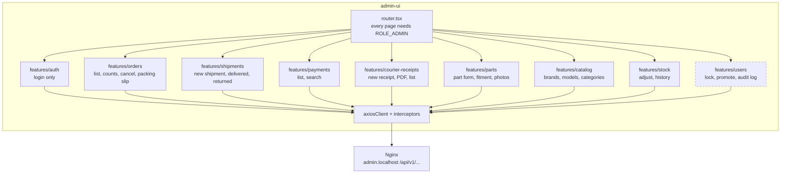

# admin-ui — components (C4 level 3)

Job: the admin site. React + TypeScript + Vite, same style as users-ui. Dev port 3001,
opened through Nginx at `http://admin.localhost` (M10). **Built:** every page except Users (user-service has no admin endpoints yet). The Stock page is part of the part page (`/parts/:id`: photos, stock change, stock history).

## Pages, and what you change on each

Each status is changed on **one** page only. The Orders page shows everything, but changes only orders.

| Page | Shows | You change | Calls |
|---|---|---|---|
| **Orders** | Cards: to ship, with courier, cash with couriers, overdue cash. Table: order, customer, total, `shipment_status`, `payment_status`, courier, tracking number | Cancel (before shipping), print packing slip | order-service |
| **Shipments** | Parcels with couriers, grouped by courier, oldest first | **New shipment** (order, courier, tracking number, photo); mark delivered; mark returned with a reason; many at once | order-service |
| **Payments** | Payment, order number, amount, status, courier, tracking number, receipt | Nothing (read only for cash on delivery) | payment-service |
| **Courier receipts** | Receipts: courier, number, date, collected, fees, received, PDF | **New receipt**: details + PDF + tick the Collected parcels → they become Paid | payment-service |
| **Parts** | Parts with search, hidden ones too | Add, edit, hide; fitment; photos | product-service |
| **Catalog** | Bike brands, bike models, categories | Add, edit, hide | product-service |
| **Stock** | Stock per part, history | Add or remove with a reason | product-service |
| **Users** | Users, roles, audit log | Lock, unlock, make admin | user-service |

## Notes

- **Login is separate from the customer site.** `admin.localhost` and `localhost` are different
  host names, so the browser keeps separate cookies. An admin logs in on the admin site.
- **Hiding a button is not security.** Every service checks `ROLE_ADMIN` on every admin endpoint.
- **Packing slip** is a printable page made from the order data: order number, address, phone, lines, cash to collect.
