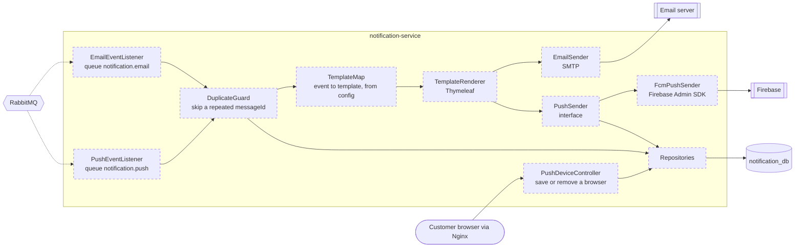

# notification-service — components (C4 level 3)

Job: turn events into **emails and push messages**, and remember which browsers allowed push.
Port 8083. Domain-free: it only knows "event name → template → fill the blanks → send".
Everything here is **Planned**.

## Parts

| Part | Job |
|---|---|
| EmailEventListener | Reads `notification.email`. Sends to the `email` in the event body. |
| PushEventListener | Reads `notification.push`. Looks up every saved browser of the `userId` in the event body. |
| DuplicateGuard | Checks `messageId` + channel in `sent_notifications`. Already there? Stop. |
| TemplateMap | In `application.yaml`: event name → email template + subject, and push title + text. The **only** place event names appear (M20). |
| TemplateRenderer | Fills the templates with values from the event body |
| EmailSender | SMTP. Mailpit in dev. |
| PushSender | Interface: "send this title and text to this device token" |
| FcmPushSender | The only class that knows Firebase. If Firebase says a token is no longer valid, the device row is deleted. |
| PushDeviceController | `POST` saves the browser's Firebase token for the logged-in user; `DELETE` removes it (logout, or the user turned push off) |
| Repositories | `push_devices`, `sent_notifications` |

## The template map

| Event | Email | Push |
|---|---|---|
| `user.registered` | welcome | — |
| `user.password.reset` | password-reset | — |
| `user.password.changed` | password-changed | — |
| `order.placed` | order-placed | "Order MX-10238 received" |
| `order.shipped` | order-shipped (with courier and tracking number) | "Your order is on its way" |
| `order.delivered` | order-delivered | "Your order was delivered" |
| `order.returned` | order-returned | "Your order came back to us" |
| `order.cancelled` | order-cancelled | "Your order was cancelled" |

The two templates in `user-service/src/main/resources/templates/emails/` move here.

## When sending fails

1. The listener throws an error, so the message is not lost.
2. It is tried again: 3 tries in all, 2 seconds then 4 seconds apart (settings in `application.yaml`).
3. After that it goes to the dead-letter queue `notification.email.dlq` or `notification.push.dlq` for a person to check.
   A message that can never work (no `messageId`, no email address) goes there at once (M38).

## Settings

SMTP host and port, Firebase service-account key (a secret file, `firebase.json`, ignored by git), template map, queue names.
Check the Firebase documentation for the exact Admin SDK Maven coordinates; do not guess them.

Tables: [08-data-model.md](../08-data-model.md#notification_db). Endpoints: [10-api-map.md](../10-api-map.md#notification-service-8083).
