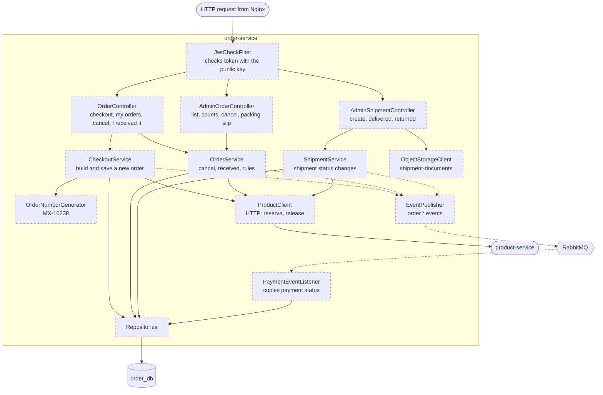

# order-service — components (C4 level 3)

Job: checkout, orders, **shipments**, and a copy of each order's payment status. Port 8082.
Not domain-free. Everything here is **Planned**.

## Parts

| Part | Job |
|---|---|
| JwtCheckFilter | Customer endpoints need a login and only show **your own** orders. Admin endpoints need `ROLE_ADMIN`. |
| OrderController | Customer: checkout, my orders, one order, cancel, "I received it" |
| AdminOrderController | Admin: order list with both status columns, dashboard counts (to ship, with courier, overdue cash), cancel, packing slip data |
| AdminShipmentController | Admin: create shipment (courier, tracking number, optional photo), mark delivered, mark returned (one or many) |
| CheckoutService | 1) check the lines, 2) reserve stock and get real prices from product-service, 3) add the delivery fee, 4) save the order (`NOT_SHIPPED`, `PENDING`), 5) publish `order.placed` |
| OrderService | Cancel (only `NOT_SHIPPED`), release stock, publish `order.cancelled`; save "customer confirmed receipt" time |
| ShipmentService | Create a shipment → order `IN_TRANSIT` + `order.shipped`. Delivered → `DELIVERED` + `order.delivered`. Returned → release stock, `RETURNED` + `order.returned`. Tracking number must be unique. |
| OrderNumberGenerator | Readable unique number like `MX-10238` |
| ProductClient | HTTP calls to product-service internal endpoints, with the trace id |
| PaymentEventListener | Reads `payment.collected`, `payment.succeeded`, `payment.cancelled` and updates the order's `payment_status` copy. Skips repeated `messageId`s. |
| EventPublisher | Publishes `order.*` events after the commit (M19) |
| ObjectStorageClient | Saves the optional pickup-receipt photo in its own **private** bucket `shipment-documents` (M18) |
| Repositories | `orders`, `order_items`, `shipments`, `processed_messages` |

The order never changes `payment_status` on its own. Only `payment.*` events change it (M3).

## Settings in `application.yaml`

Delivery fee, currency `LKR`, order number prefix `MX-`, list of couriers, overdue-cash days (14),
product-service base URL and timeouts, RabbitMQ queue, public key location, object storage settings (S3 address, its own keys, bucket `shipment-documents`).

Tables: [08-data-model.md](../08-data-model.md#order_db). Endpoints: [10-api-map.md](../10-api-map.md#order-service-8082).
