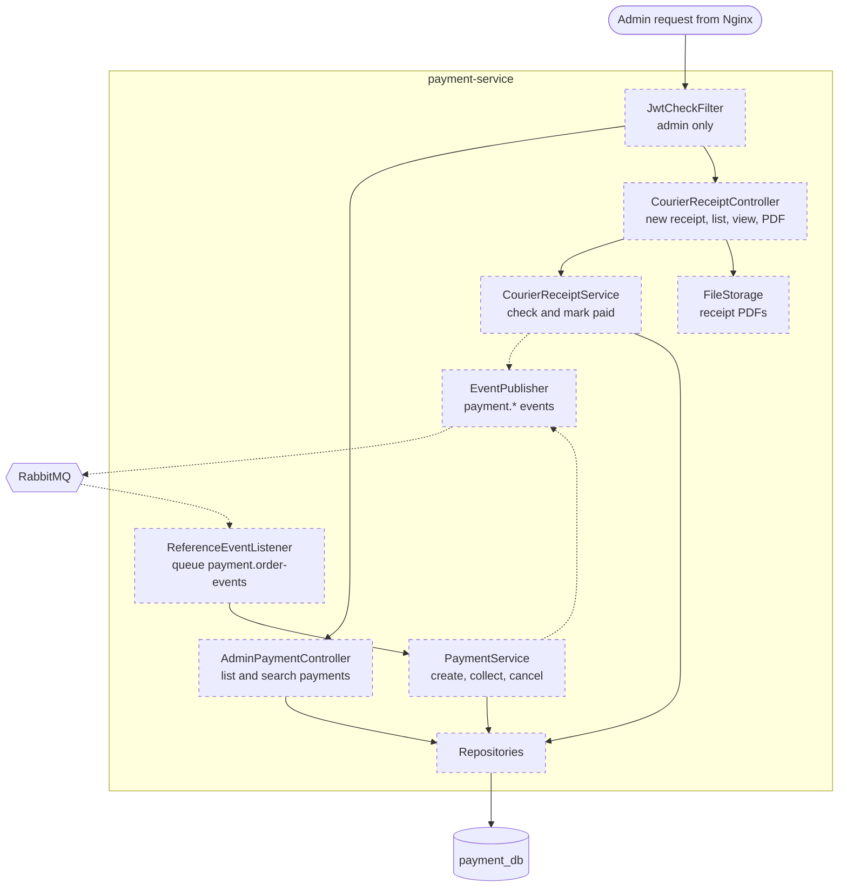

# payment-service — components (C4 level 3)

Job: payments and courier receipts. Cash on delivery only in the MVP. Port 8084.
Domain-free: it says `reference`, never "order". Everything here is **Planned**.

## Parts

| Part | Job |
|---|---|
| JwtCheckFilter | Every endpoint needs `ROLE_ADMIN`. Customers never call payment-service. |
| AdminPaymentController | List payments; filter by status, courier, reference, tracking number |
| CourierReceiptController | Create a receipt (courier, receipt number, bank reference, date, amount received, PDF, list of tracking numbers); list; view; download the PDF |
| ReferenceEventListener | Reads the five order events (table below). Skips repeated `messageId`s. |
| PaymentService | Creates and moves payments. Publishes `payment.collected` and `payment.cancelled`. |
| CourierReceiptService | Checks every tracking number: it must exist, belong to that courier, and be `COLLECTED`. Then, in **one** transaction, it saves the receipt and marks those payments `PAID`. After the commit it publishes one `payment.succeeded` each. |
| FileStorage | Saves receipt PDFs and photos (M18) |
| EventPublisher | `payment.collected`, `payment.succeeded`, `payment.cancelled` |
| Repositories | `payments`, `courier_receipts`, `processed_messages` |

## What each order event does to a payment

| Event heard | Payment change |
|---|---|
| `order.placed` | Create payment: method `COD`, amount, status `PENDING` |
| `order.shipped` | Save courier and tracking number on the payment |
| `order.delivered` | `PENDING` → `COLLECTED`, then publish `payment.collected` |
| `order.returned` | `PENDING` → `CANCELLED`, then publish `payment.cancelled` |
| `order.cancelled` | `PENDING` → `CANCELLED`, then publish `payment.cancelled` |

The event names contain the word "order", so they live only in `application.yaml` (the queue
bindings). The Java code sees a generic "reference event" (M20 idea, applied here).

## Later: card payments

Add method `CARD`, a `PaymentGateway` interface and a OnePay adapter (`../architecture/`).
The tables, pages and events above stay the same.

## Settings in `application.yaml`

Queue name and bindings, list of couriers, overdue days, file folder and max PDF size, public key location.

Tables: [08-data-model.md](../08-data-model.md#payment_db). Endpoints: [10-api-map.md](../10-api-map.md#payment-service-8084).
