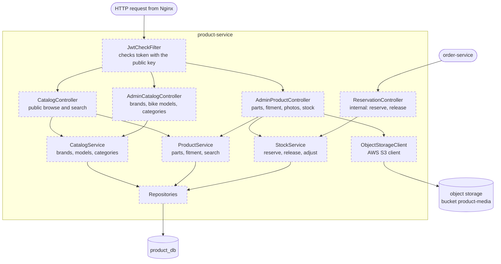
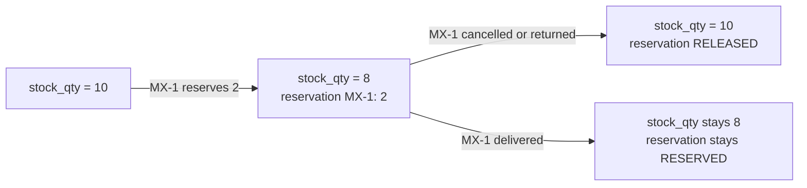

# product-service — components (C4 level 3)

Job: the catalog (bike brands, bike models, categories, parts, fitment, photos) and stock.
Port 8081. Not domain-free: this is the heart of the shop. Everything here is **Planned**.

## Parts

| Part | Job |
|---|---|
| JwtCheckFilter | Admin endpoints need `ROLE_ADMIN`. Public endpoints need no login. |
| CatalogController | Public: brands, models of a brand, categories, search parts, one part, photos |
| AdminCatalogController | Create, edit, hide brands, bike models, categories (BR3, BR4) |
| AdminProductController | Create, edit, hide parts; fitment; upload photos; adjust stock; stock history |
| ReservationController | **Internal** (`/internal/...`), only order-service calls it, Nginx never routes it |
| CatalogService | Example rule: cannot hide a category that active parts use |
| ProductService | Example rule: part number must be unique. Search by number, name, category, bike model. |
| StockService | Reserve for an order, release on cancel **or return**, admin adjustments. Every change is written to `stock_movements`. Locks the part row while changing stock. |
| ObjectStorageClient | Puts and deletes files in its own bucket `product-media` (public read) with the AWS SDK S3 client (M18). Saves only the object key. Address and keys come from `env/product-service.env`. |
| Repositories | `brands`, `bike_models`, `categories`, `products`, `product_fitments`, `product_images`, `stock_reservations`, `stock_movements` |

## Stock in one picture

Each reservation is saved with the order number, so releasing the same order twice does nothing
the second time (idempotent).

## Settings in `application.yaml`

File folder, max photo size, max photos per part (5), search page size, public key location.

Tables: [08-data-model.md](../08-data-model.md#product_db). Endpoints: [10-api-map.md](../10-api-map.md#product-service-8081).
