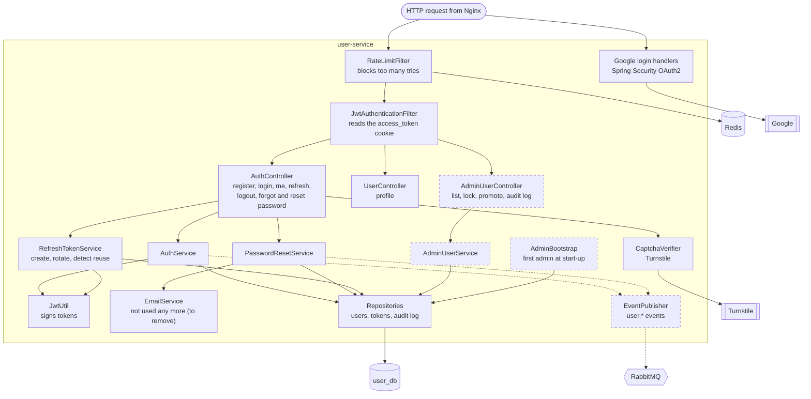

# user-service — components (C4 level 3)

Job: accounts, login, tokens, roles, and admin tools for users. Port 8080. Domain-free.
Solid border = **Built**. Dashed border = **Planned** for the MVP.

## Parts

| Part | Job | Status |
|---|---|---|
| RateLimitFilter | Counts tries per IP and email in Redis; returns 429 when over the limit | Built |
| JwtAuthenticationFilter | Reads the `access_token` cookie, checks it, sets who the user is | Built |
| AuthController | All `/api/v1/user/auth/...` endpoints | Built |
| UserController | `/api/v1/user/profile` | Built |
| Google login handlers | Success and failure handlers for "Continue with Google" | Built |
| AuthService, PasswordResetService, RefreshTokenService | The login, reset and refresh logic | Built |
| CaptchaVerifier | Interface; `TurnstileVerifier` checks the CAPTCHA token | Built |
| JwtUtil | Creates and reads access tokens. **MVP change:** sign with an RS256 private key (decision M9) | Built, to change |
| EmailService | Used to send the emails itself. Nothing calls it now (M44). **To remove** after your OK: the class, `templates/emails`, `AsyncConfig`, the mail settings and the mail and Thymeleaf dependencies | Built, unused |
| EventPublisher + AccountEvents | Publish `user.registered` (form and Google), `user.password.reset`, `user.password.changed` after the commit. Event names are in `events.*` (M44) | Built |
| RequestIdFilter | Gives every request a trace id (`X-Request-Id`); it goes into the logs and the `traceId` header of events | Built |
| Flyway | `db/migration/V1__create_tables.sql`; Hibernate only validates (`ddl-auto: validate`). Checked on PostgreSQL 17 | Built |
| AdminUserController + AdminUserService | List users, lock and unlock, give or take ROLE_ADMIN, write the audit log. An admin cannot change their own account, and a demoted or locked admin cannot act even with an unexpired token. | Built |
| AdminBootstrap | At start-up, if no admin exists: promotes `admin.bootstrap.email`, or creates it with `admin.bootstrap.password`. Does nothing once an admin exists. | Built |
| Repositories | `users`, `refresh_tokens`, `password_reset_token`, `admin_audit_log` | Built + 1 planned |

## Settings in `application.yaml` (never in Java)

Token lifetimes, cookie names and paths, rate-limit rules, CAPTCHA keys,
the first admin's email (`AdminBootstrap`), the private key location, RabbitMQ connection.

Tables: [08-data-model.md](../08-data-model.md#user_db). Endpoints: [10-api-map.md](../10-api-map.md#user-service-8080).
