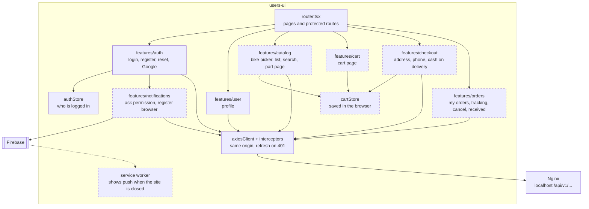

# users-ui — components (C4 level 3)

Job: the customer site. React + TypeScript + Vite. Dev port 3000, opened through Nginx at
`http://localhost`. Solid border = **Built**. Dashed border = **Planned**.

## Parts

| Part | Job | Calls | Status |
|---|---|---|---|
| router | Pages; protected pages send a visitor to `/login` | — | Built (add pages) |
| features/auth | Login, register, forgot and reset, Google | user-service | Built |
| features/user | Profile | user-service | Built |
| features/catalog | Brand → model picker, part list, search, part page with photos and fitting bikes | product-service | Planned |
| features/cart | Change quantity, remove | browser only | Planned |
| features/checkout | Address, city, district, phone; shows "pay X LKR in cash"; places the order | order-service | Planned |
| features/orders | My orders; one order with simple status, courier and tracking number; Cancel (before shipping); I received it | order-service | Planned |
| features/notifications | After login: ask "Allow notifications?". If yes, get a Firebase token and send it to notification-service. On logout, remove it. | Firebase JS SDK, notification-service | Planned |
| service worker | A small script the browser keeps running; it shows the push message even when no tab is open | Firebase | Planned |
| authStore | Logged-in user (zustand) | user-service `/me` | Built |
| cartStore | Cart lines; saved in the browser (decision 37) | — | Planned |
| axiosClient + interceptors | One HTTP client; refresh once on `ACCESS_TOKEN_EXPIRED` | — | Built |

The cart shows prices only as a hint. order-service decides the real price at checkout.

## Status words the customer sees

| `shipment_status` | Customer sees |
|---|---|
| `NOT_SHIPPED` | Order placed |
| `IN_TRANSIT` | Shipped · Courier A · WB55310 |
| `DELIVERED` | Delivered |
| `RETURNED` | Returned to us |
| `CANCELLED` | Cancelled |

The customer never sees `payment_status`. For them, they paid at the door.

## Pages

| Page | Login | Status |
|---|---|---|
| `/login`, `/register`, `/forgot-password`, `/reset-password` | No | Built |
| `/profile` | Yes | Built |
| `/` (home, bike picker) | **No** — today it needs a login; must become public (BR1) | Change |
| `/parts`, `/parts/:id`, `/bikes/:brand/:model`, `/cart` | No | Planned |
| `/checkout`, `/orders`, `/orders/:orderNo` | Yes | Planned |

Push on iPhone works only after the customer adds the site to the home screen. Test on Android
and desktop first.
