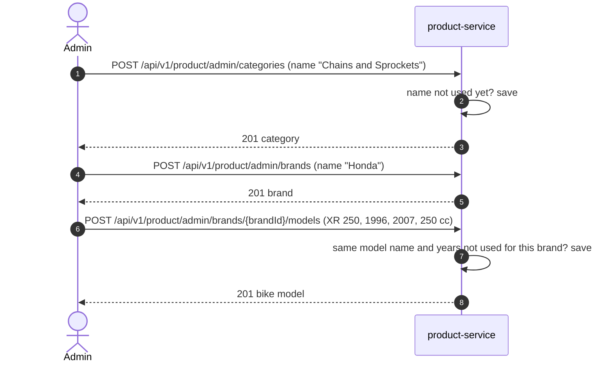
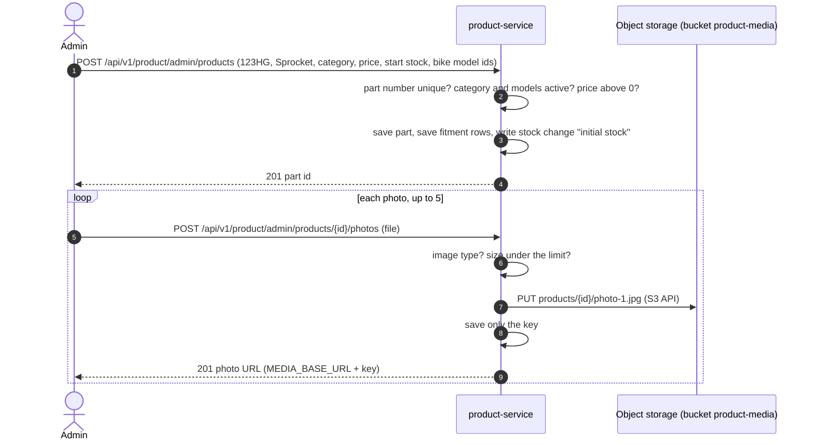
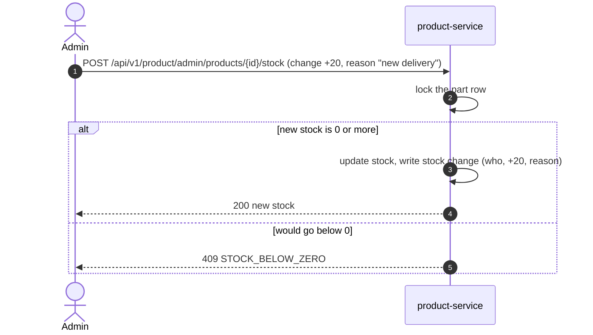
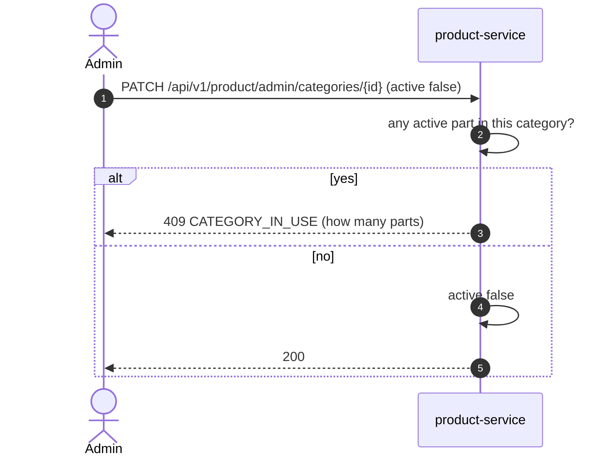

# Admin: catalog and stock

All **Planned**. Every call needs `ROLE_ADMIN`. product-service checks it on every request.

## 1. Set up the catalog: category, bike brand, bike model

## 2. Add a part, with fitment and photos

## 3. Add or remove stock

The lock in step 2 stops an admin change and a customer order from overwriting each other.

## 4. Hide a category that is still used

Bike models follow the same rule (BR4).
