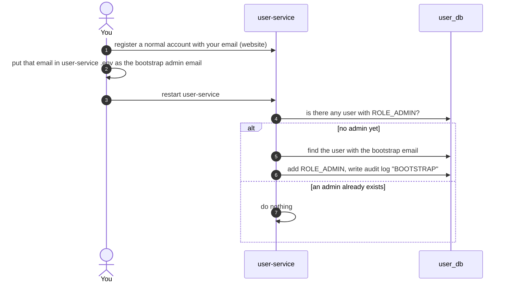
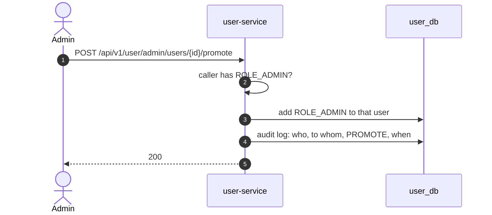
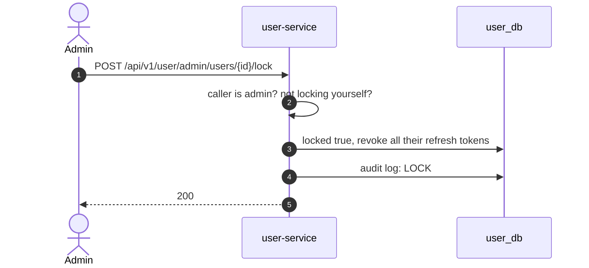

# Admin: users and roles

All **Planned**. Based on decision 8: the first admin by bootstrap, the next ones by promotion, with an audit log.

## 1. The first admin (bootstrap)

No password is ever written in config or git. The account is created normally first.
If the email is not found, user-service logs a warning and starts anyway.

## 2. An admin makes another user an admin

The new admin's role shows up in their **next** access token. Their current token
still says "not admin" for up to 15 minutes (the token life), or until they log in again.

## 3. Lock a user

A locked user cannot log in or refresh (Built: login already refuses locked accounts).
Their current access token still works until it expires (up to 15 minutes).

## Cookies and the two sites

Browsers keep cookies per **host name**. `localhost` (customer site) and `admin.localhost`
(admin site) are different host names, so they have **separate** cookies (decision M10).
An admin logs in on the admin site with email and password. Being logged in as a customer on
`localhost` does not log you in on `admin.localhost`. Every admin call still needs `ROLE_ADMIN`.
