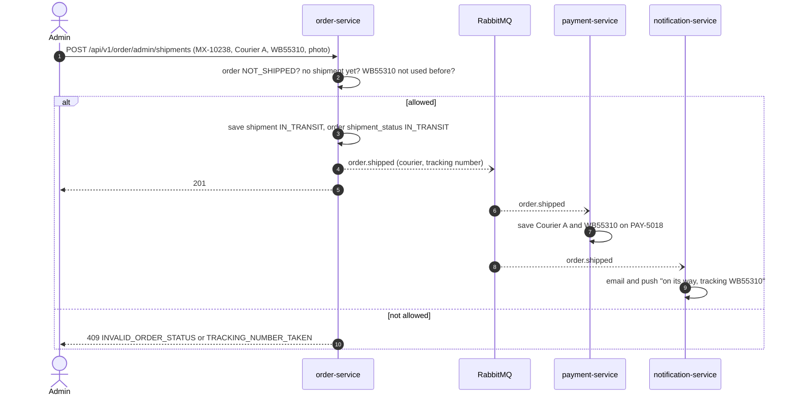
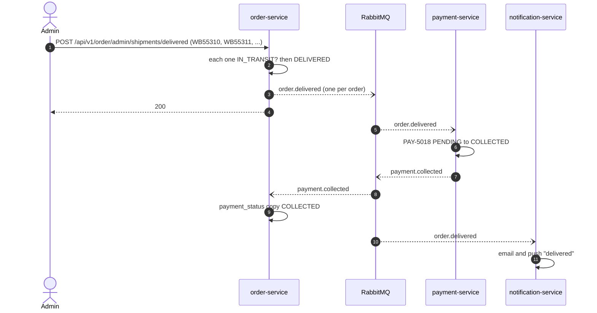
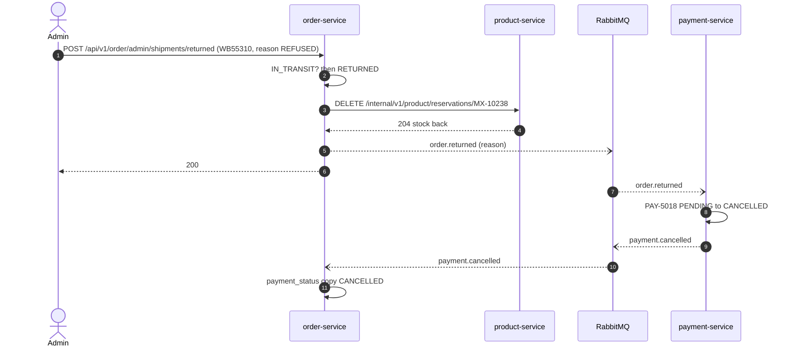
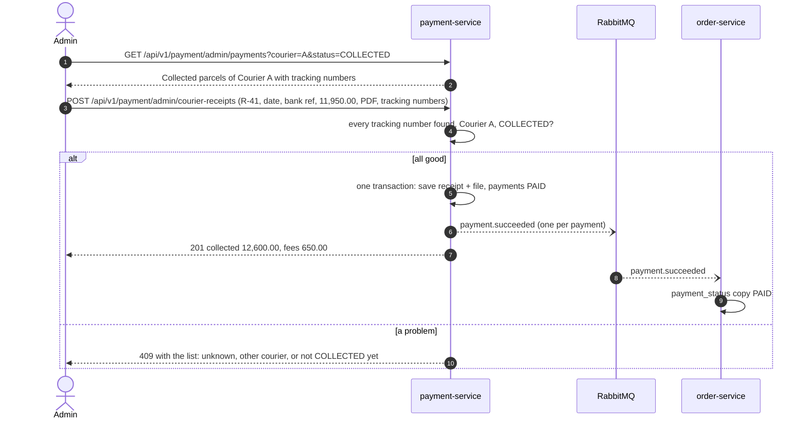
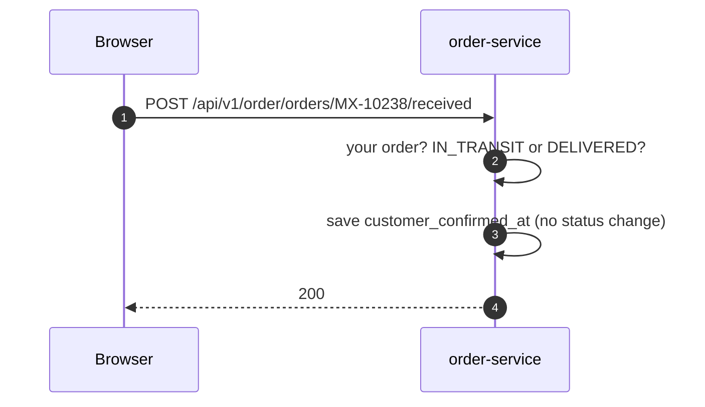

# Shipping and cash from the courier

All **Planned**. The allowed status moves are in [09-state-diagrams.md](../09-state-diagrams.md).

## 1. Create a shipment

The admin has packed the parcel, handed it to the courier, and has the pickup receipt with
tracking number WB55310.

## 2. Mark delivered (the courier has the cash)

## 3. Mark returned (the courier brought it back)

Return reasons: `REFUSED`, `NOT_REACHABLE`, `WRONG_ADDRESS`, `OTHER`.
If the part came back damaged, the admin removes it with a stock adjustment.

## 4. The courier pays: enter a courier receipt

If a parcel on the receipt is still `PENDING`, the admin has not marked it delivered yet.
The answer says "mark WB55312 delivered first". Money is never accepted for a parcel that
the system thinks is still on the road.

## 5. Customer presses "I received it"

The admin sees "customer confirmed" on the order. It is evidence only (M21).
