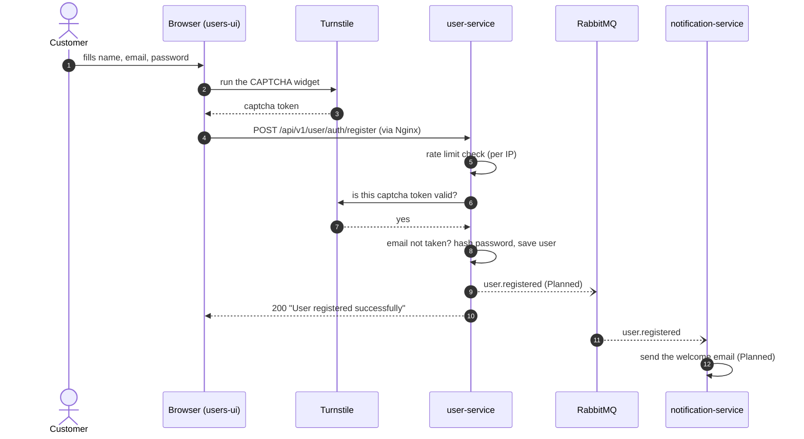
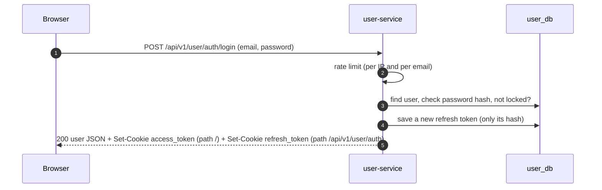
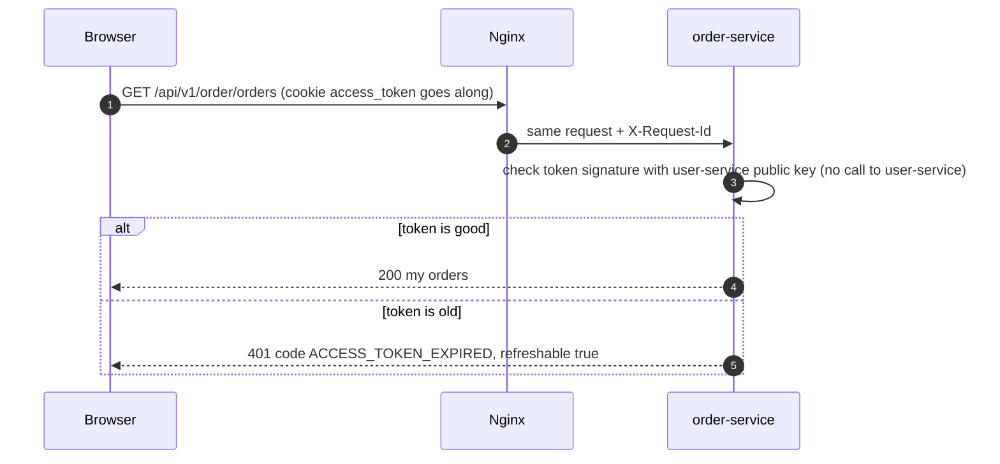
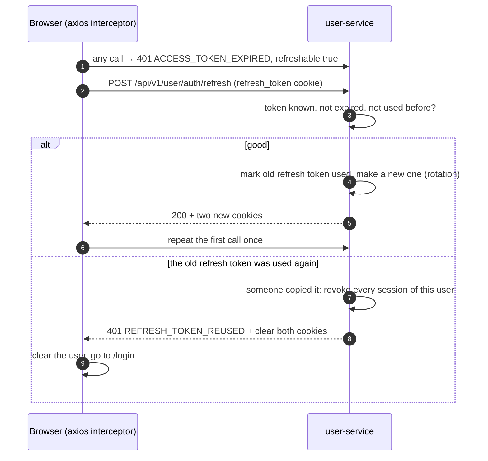
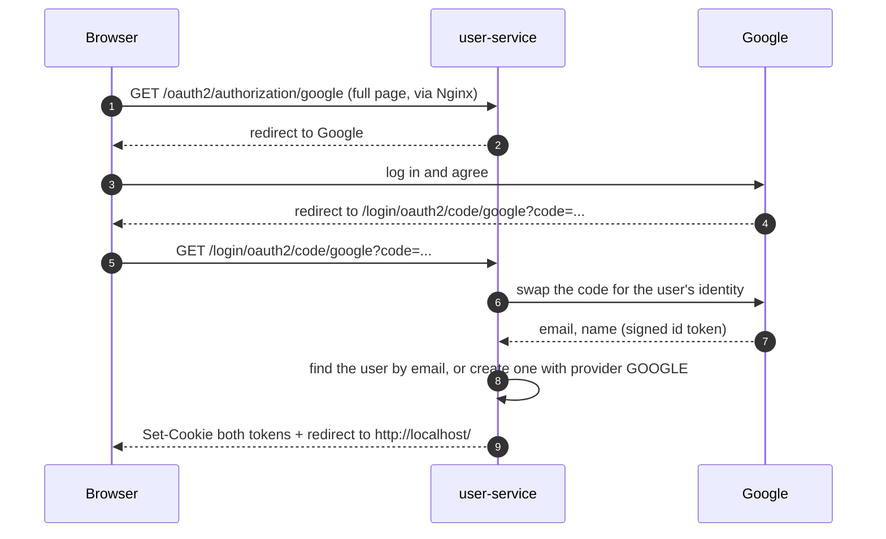
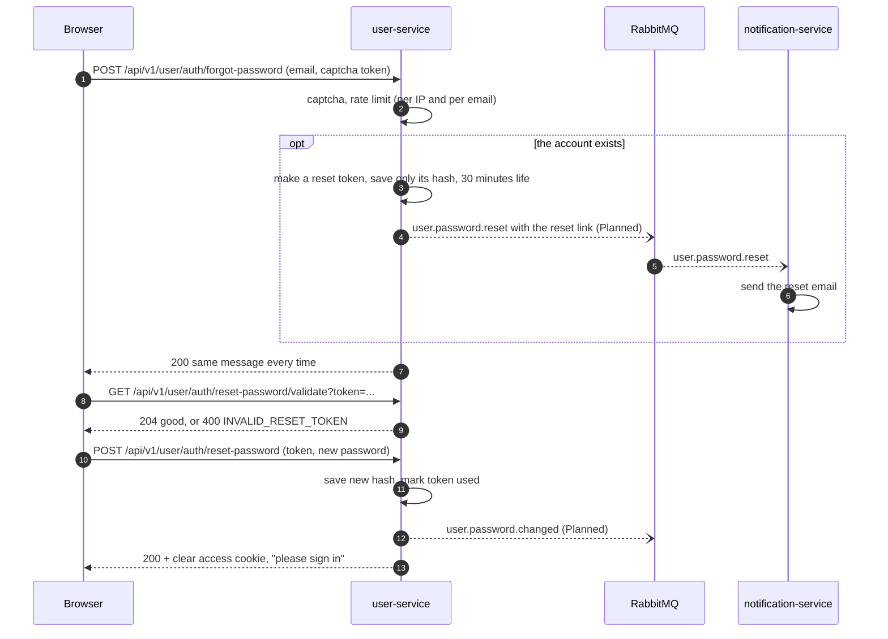

# Login and account flows

How to read: each number is one step, in time order. Solid arrow `->>` = HTTP call.
Dashed arrow `-->>` = the answer. Dotted open arrow `--)` = an event (no waiting).
**Built** steps exist in user-service today. **Planned** steps are marked.

## 1. Register

Register does **not** log the user in. The UI sends them to the login page.

## 2. Log in

Both cookies are **HttpOnly**: JavaScript cannot read them, so a script injected into the
page cannot steal them. The browser sends them on its own.

## 3. Call another service while logged in

order-service never asks user-service "is this token OK?". The public key is enough (decision M9).
That is why one service can be down and the others still work.

## 4. Refresh an old access token

If ten calls fail at the same time, the interceptor sends **one** refresh, not ten (Built).

## 5. Google login

Open: behind Nginx, Spring must build the redirect address from Nginx's forwarded headers.
Test this in the first end-to-end run. The Google console must list
`http://localhost/login/oauth2/code/google` as an allowed redirect URI.

## 6. Forgot and reset password

The answer in step 7 is the same whether or not the email exists.
So nobody can use this page to find out who has an account.

Today (Built) user-service sends these two emails itself. In the MVP it publishes the events
instead, and notification-service sends them (decision M14).
