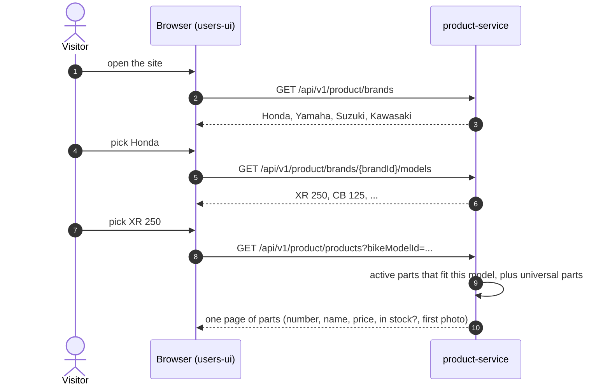
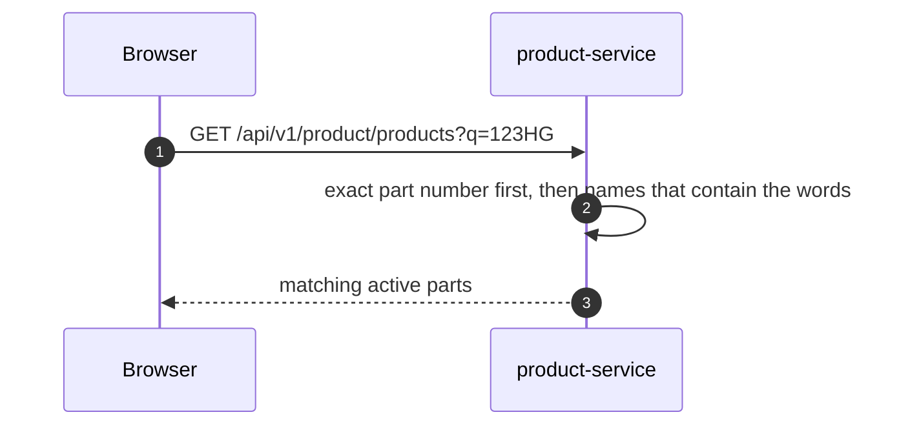
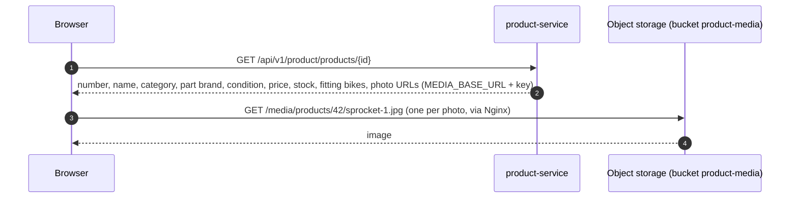
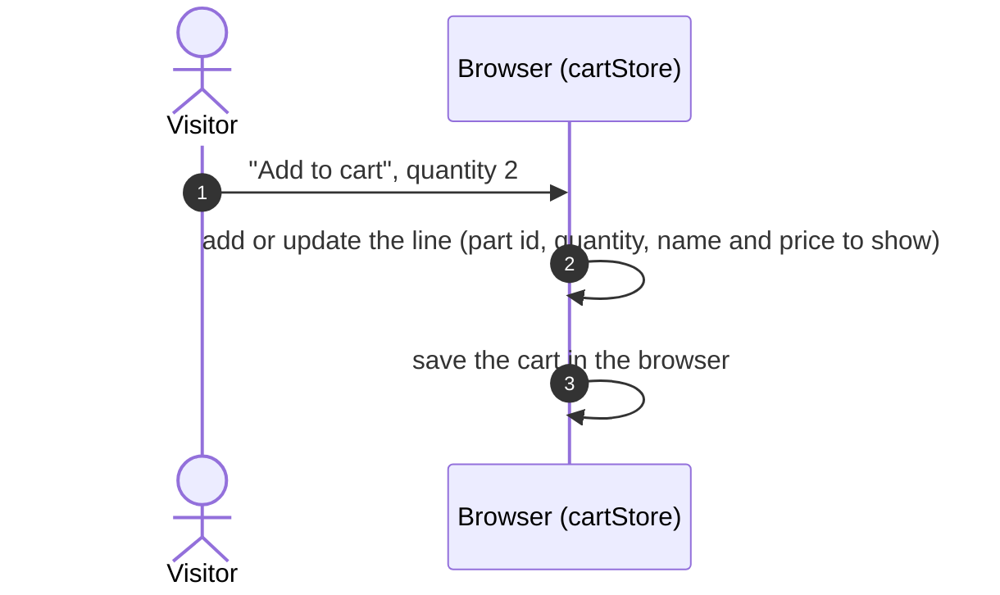

# Browse, search, cart

All **Planned**. No login needed for any step here (BR1).

## 1. Find parts for my bike

The UI keeps the chosen bike in the browser, so every later list is filtered for that bike.

## 2. Search by part number or name

## 3. Open one part

A hidden part answers `404`. Old orders still show it from their own copy (BR3, BR7).

## 4. Add to cart

No server call. The cart lives only in this browser (decision 37).
Stock is **not** reserved yet. That happens at checkout.
