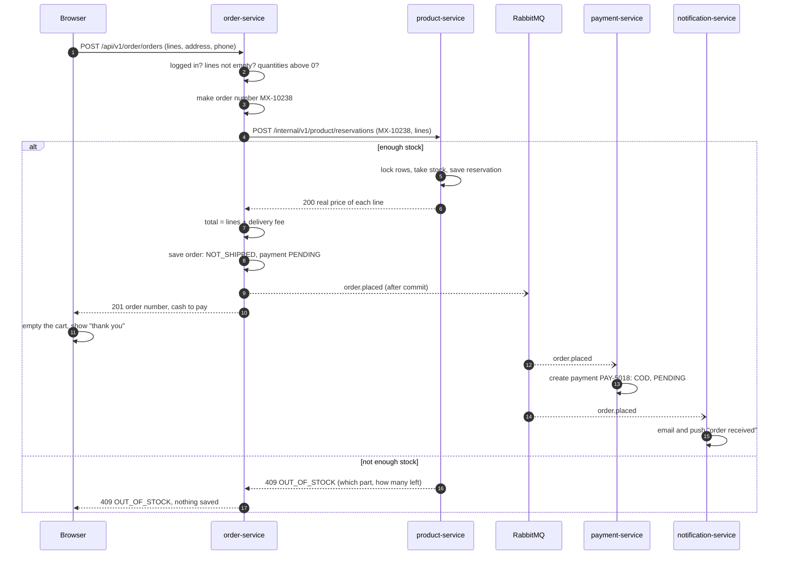
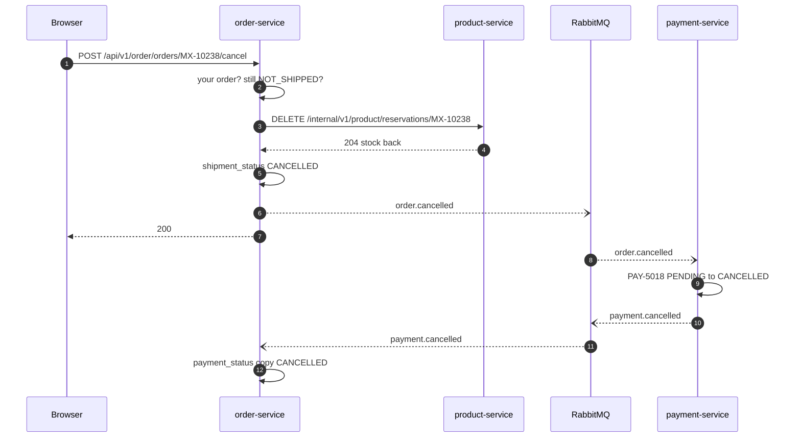

# Checkout (cash on delivery)

All **Planned**. Numbers are the order of steps. `->>` call, `-->>` answer, `--)` event.

## 1. Place an order

Points to notice:
- The price comes from product-service (step 6), never from the browser.
- If saving the order fails after step 6, order-service calls
  `DELETE /internal/v1/product/reservations/MX-10238` to give the stock back.
- The payment is created by the **event** (step 13). order-service does not wait for it.

## 2. Customer cancels before shipping

An admin cancels the same way from the Orders page (`/api/v1/order/admin/orders/{orderNo}/cancel`).
If product-service is down in step 3, the cancel fails and nothing changes. Try again.
