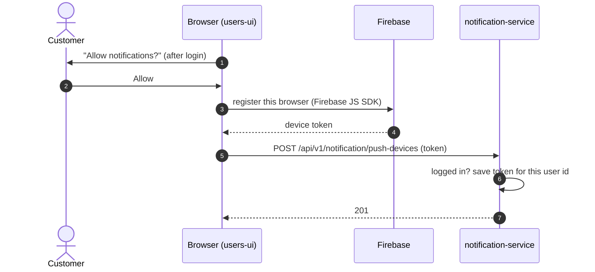
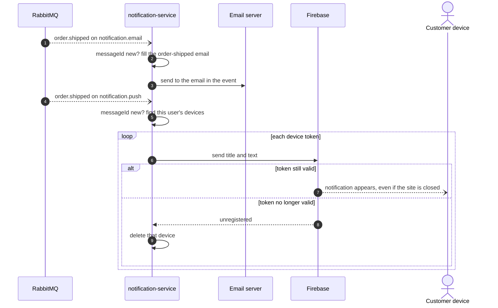

# Push notifications

All **Planned**. Push uses Firebase Cloud Messaging (M9).

## 1. The customer allows push in this browser

If the customer says "Block", nothing is saved. They still get emails.
On logout, the browser calls `DELETE /api/v1/notification/push-devices/{token}`.

## 2. An event becomes an email and a push

The same event arrives twice, once per queue. Email and push are sent independently: if one
fails and is retried, the other is not sent again.
