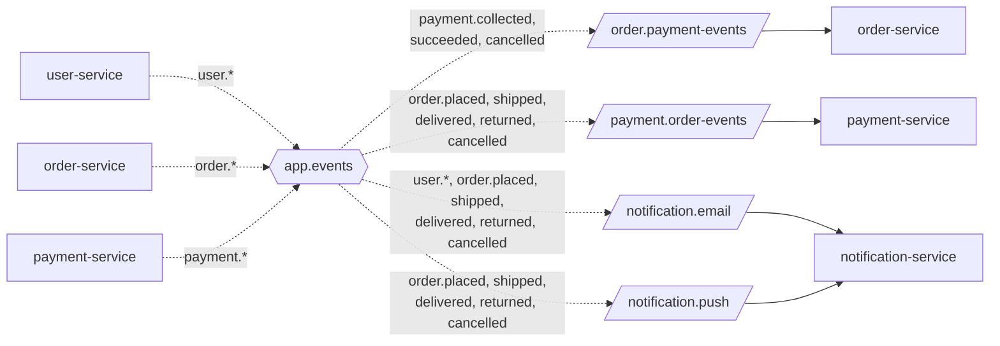

# Events (MVP)

The MVP uses part of the full contract in
[../architecture/06-event-contracts.md](../architecture/06-event-contracts.md)
(same exchange, same rules, same names), plus the **body fields** of each event.

## Rules (same as the contract)

| Item | Value |
|---|---|
| Exchange | `app.events`, type `topic`, durable |
| Event name | Past-tense fact in the publisher's words. Never renamed once bound. |
| Header `messageId` | UUID set by the publisher. Listeners skip ids already handled. |
| Header `traceId` | Proposed: the `X-Request-Id` of the request that caused the event |
| Who declares | Exchange: publisher and listener. Queue and binding: listener only. |
| When to publish | Only after the database commit (M19) |

## Picture: MVP routing

## Events in the MVP

| Event | Publisher | Queues | Published when |
|---|---|---|---|
| `user.registered` | user-service | email | A new account is created (form or Google) |
| `user.password.reset` | user-service | email | A reset link is requested for an existing account |
| `user.password.changed` | user-service | email | The password is changed |
| `order.placed` | order-service | payment, email, push | An order is saved |
| `order.shipped` | order-service | payment, email, push | The admin creates the shipment |
| `order.delivered` | order-service | payment, email, push | The admin marks the parcel delivered |
| `order.returned` | order-service | payment, email, push | The admin marks the parcel returned |
| `order.cancelled` | order-service | payment, email, push | The order is cancelled before shipping |
| `payment.collected` | payment-service | order | The courier has the cash |
| `payment.succeeded` | payment-service | order | A courier receipt marked the payment paid |
| `payment.cancelled` | payment-service | order | No money will come (cancelled or returned) |

Queue names: payment = `payment.order-events`, email = `notification.email`,
push = `notification.push`, order = `order.payment-events`.

**Kept for later, not used in the MVP:** `order.paid`, `order.refunded`, `payment.failed`,
`payment.refunded`, `product.*`, `recommendation.generated`, queues `reco.*`.

## Body fields

General rules:
- Money is a **string** with 2 decimals, e.g. `"9500.00"`, plus `currency` `"LKR"`.
- Times are ISO-8601 in UTC, e.g. `"2026-10-19T08:30:00Z"`.
- Every event that notification-service hears has **`userId`, `email`, `name`** at the top level.
  `email` is for the email; `userId` finds the push devices.
- Every `order.*` event also has **`reference`** (= the order number) for payment-service,
  which never uses the word "order".

### user.registered · user.password.reset · user.password.changed

| Field | Example | In |
|---|---|---|
| userId, email, name | `"42"`, `"nimal@example.com"`, `"Nimal Perera"` | all three |
| provider | `"LOCAL"` or `"GOOGLE"` | registered |
| resetLink, expiresInMinutes | `"http://localhost/reset-password?token=..."`, `30` | password.reset |
| changedAt | time | password.changed |

`user.password.reset` holds a secret link. Never write its body to a log.

### order.placed

| Field | Example |
|---|---|
| orderNo, reference | `"MX-10238"`, `"MX-10238"` |
| userId, email, name | as above |
| paymentMethod | `"COD"` |
| itemsTotal, deliveryFee, total, currency | `"9000.00"`, `"500.00"`, `"9500.00"`, `"LKR"` |
| lines | list of `{ partNumber, name, quantity, unitPrice, lineTotal }` |

### order.shipped · order.delivered · order.returned · order.cancelled

| Field | Example | In |
|---|---|---|
| orderNo, reference, userId, email, name | as above | all four |
| courier, trackingNumber | `"Courier A"`, `"WB55310"` | shipped, delivered, returned |
| shippedAt | time | shipped |
| deliveredAt | time | delivered |
| reason, returnedAt | `"REFUSED"`, time | returned |
| cancelledBy, cancelledAt | `"CUSTOMER"` or `"ADMIN"`, time | cancelled |

### payment.collected · payment.succeeded · payment.cancelled

| Field | Example | In |
|---|---|---|
| paymentId, reference | `"PAY-5018"`, `"MX-10238"` | all three |
| amount, currency | `"9500.00"`, `"LKR"` | all three |
| collectedAt | time | collected |
| courierReceiptNo, paidAt | `"R-41"`, time | succeeded |
| cancelledAt | time | cancelled |
