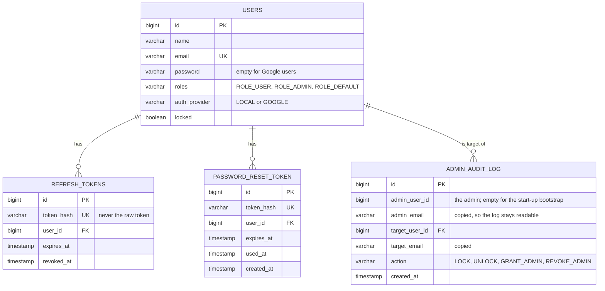
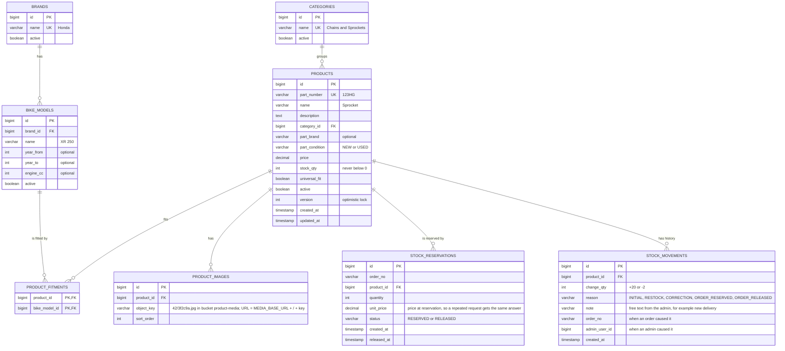
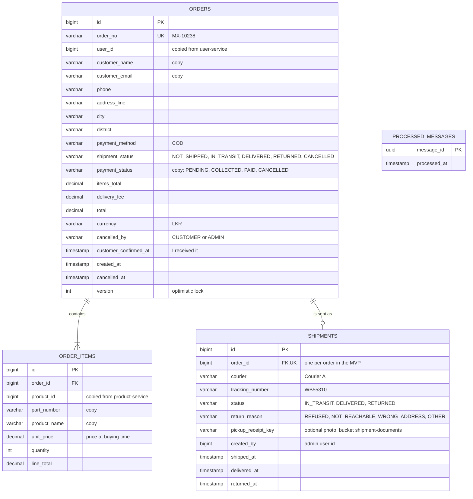
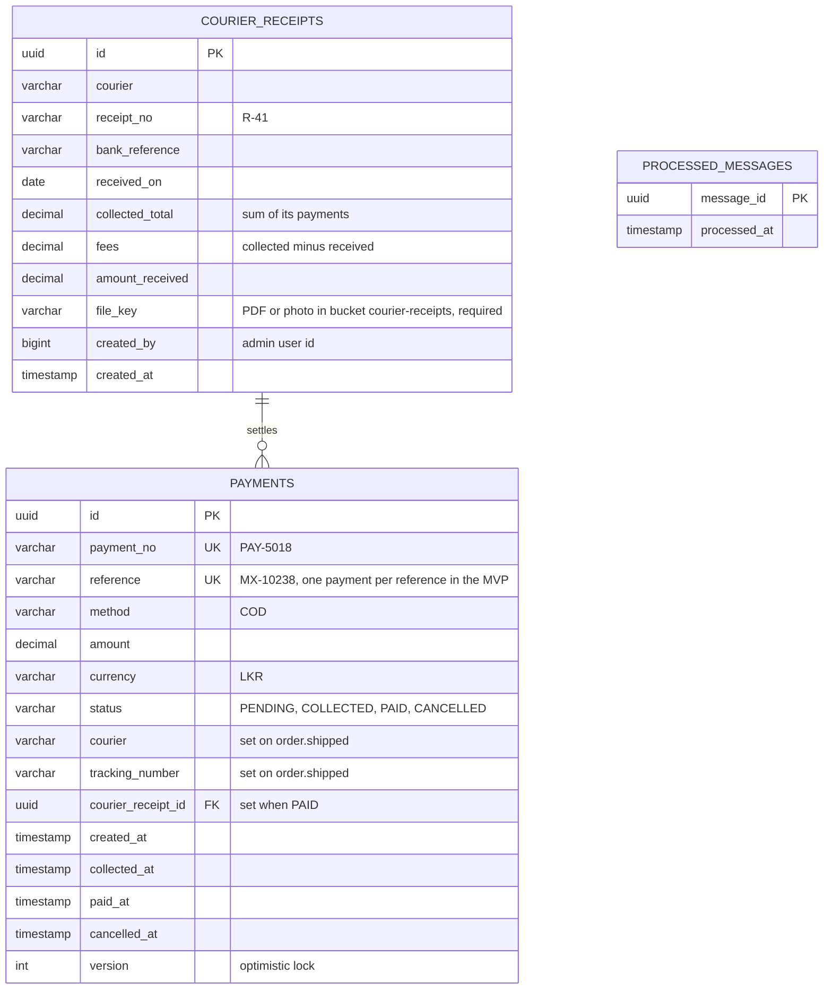
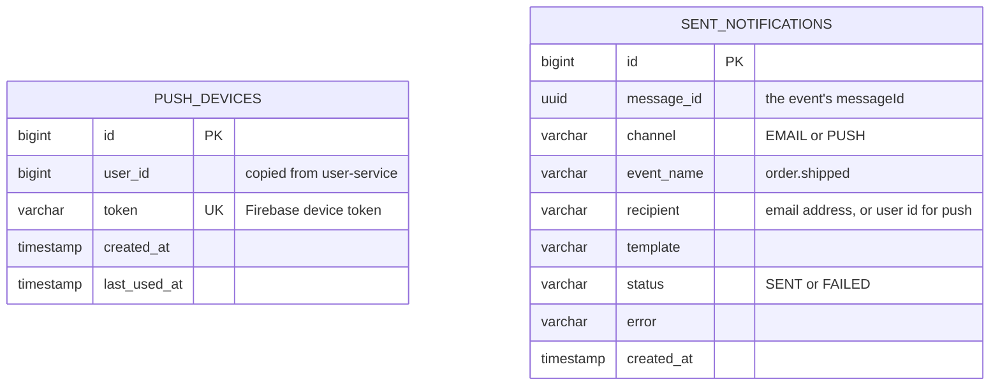

# Data model (MVP)

One section per database. Each service owns one database (decision 2).
There are **no foreign keys between databases**: `user_id` in `order_db` is just a copied number.

`PK` primary key · `FK` foreign key (same database) · `UK` unique ·
`decimal` = money: `numeric(12,2)` in SQL, `BigDecimal` in Java.
These diagrams are the plan for the **Flyway** SQL files.

## user_db

Owner: user-service. All four tables are **Built** (Flyway `V1__create_tables.sql` and `V2__create_admin_audit_log.sql`).

`users.roles` is a `varchar(255) array` column (that is how Hibernate maps a `List<Role>`). The migration copies
the SQL that Hibernate made. To ask "does any admin exist?" the code joins the array with `array_to_string`
(`array_contains` fails on H2 because Hibernate writes an enum literal as a number).

## product_db

Owner: product-service. **Planned**.

Extra unique rules: `bike_models` (`brand_id`, `name`, `year_from`); `stock_reservations` (`order_no`, `product_id`).

## order_db

Owner: order-service. **Planned**.

- `shipments`: (`courier`, `tracking_number`) is unique (BR11).
- `order_id` is unique only in the MVP. Remove that rule later to allow split deliveries.
- `PROCESSED_MESSAGES` remembers handled event ids. Insert it in the **same** transaction as the change.

## payment_db

Owner: payment-service. **Planned**. No word "order": it says `reference`.

- `courier_receipts`: (`courier`, `receipt_no`) is unique, so the same receipt cannot be entered twice.
- `payments`: index on (`courier`, `tracking_number`) to match receipt lines fast.
- Card payments later: drop the unique rule on `reference` (a failed try, then a good one).

## notification_db

Owner: notification-service. **Planned**.

`sent_notifications`: (`message_id`, `channel`) is unique. That is the duplicate check.

## Databases on the PostgreSQL server

| Database | DB user | In `01-create-databases.sql` today? |
|---|---|---|
| `user_db` | `user_service` | Yes |
| `product_db` | `product_service` | Yes |
| `order_db` | `order_service` | Yes |
| `notification_db` | `notification_service` | Yes |
| `payment_db` | `payment_service` | Yes |
