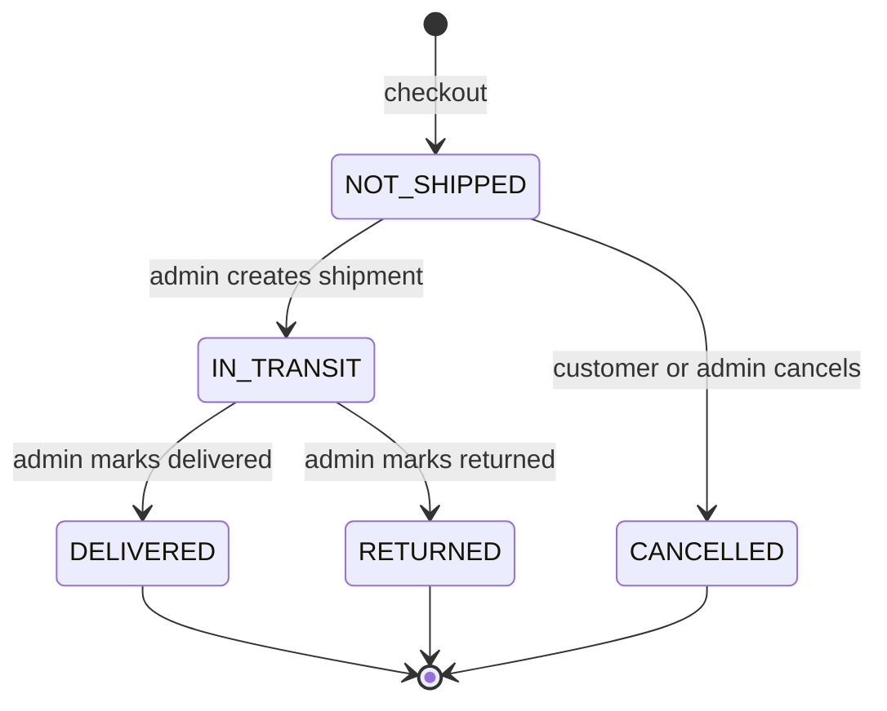
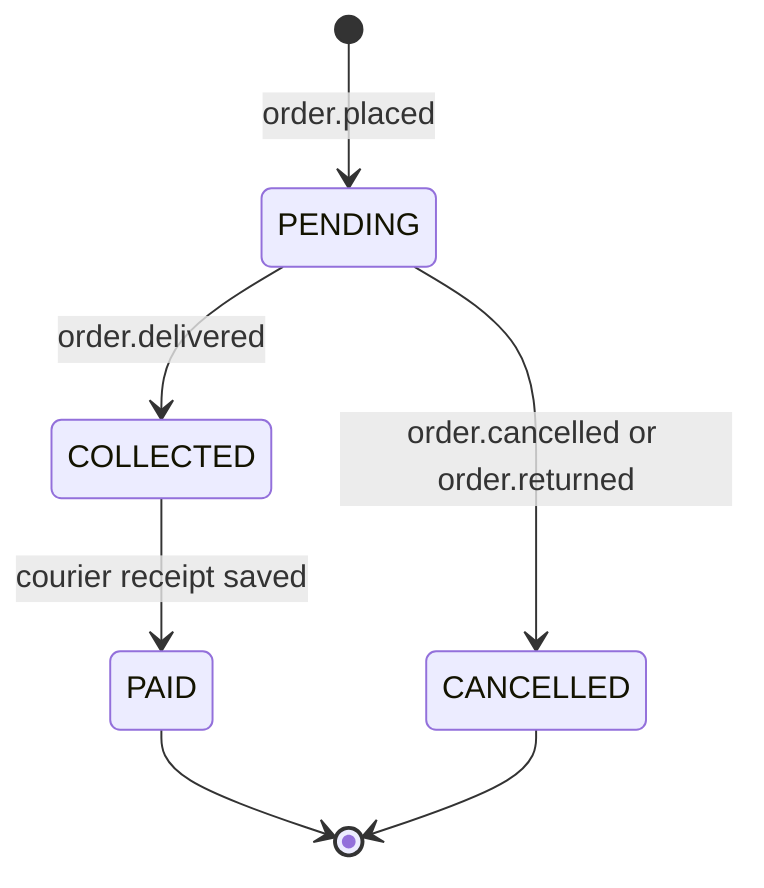
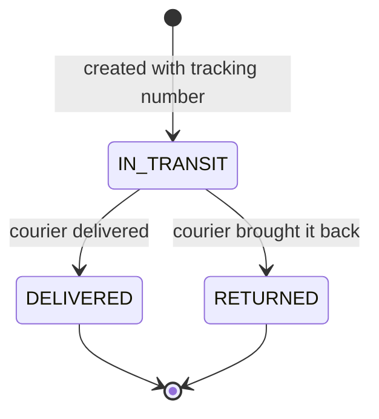
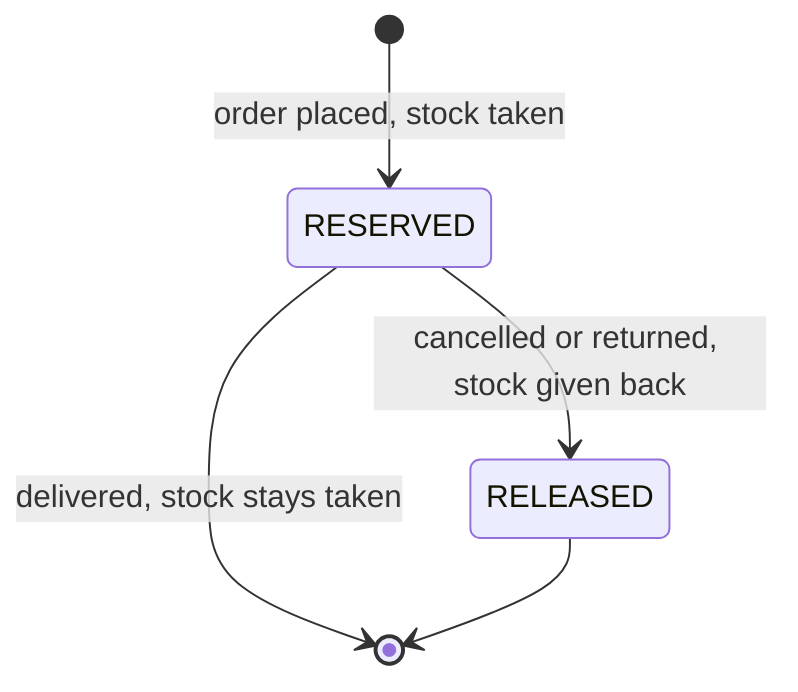

# State diagrams (MVP)

A state diagram shows every status a thing can have and every allowed move.
If a move is not drawn, the code must refuse it (`409 INVALID_ORDER_STATUS`).

An order has two status columns (M4): **`shipment_status`** (where the parcel is) and
**`payment_status`** (where the money is, copied from payment-service).

## 1. Order `shipment_status` (order-service)

## 2. Payment status (payment-service owns it; the order shows a copy)

## 3. Both together

The four normal paths:

| Path | `shipment_status` | `payment_status` |
|---|---|---|
| Happy | NOT_SHIPPED → IN_TRANSIT → DELIVERED | PENDING → COLLECTED → PAID |
| Cancelled before shipping | NOT_SHIPPED → CANCELLED | PENDING → CANCELLED |
| Returned by the courier | NOT_SHIPPED → IN_TRANSIT → RETURNED | PENDING → CANCELLED |
| Delivered, courier not paid yet | … → DELIVERED | … → COLLECTED (overdue after 14 days) |

What each action is allowed to do:

| Action | Page | Allowed when | Changes |
|---|---|---|---|
| Create shipment | Shipments | `NOT_SHIPPED`, no shipment yet, tracking number unused | → `IN_TRANSIT`, `order.shipped` |
| Mark delivered | Shipments | `IN_TRANSIT` | → `DELIVERED`, `order.delivered` → payment `COLLECTED` |
| Mark returned | Shipments | `IN_TRANSIT` | stock released, → `RETURNED`, `order.returned` → payment `CANCELLED` |
| Cancel | Orders / customer | `NOT_SHIPPED` | stock released, → `CANCELLED`, `order.cancelled` → payment `CANCELLED` |
| Save courier receipt | Courier receipts | every payment `COLLECTED`, same courier | payments → `PAID`, `payment.succeeded` |
| I received it | customer | `IN_TRANSIT` or `DELIVERED` | no status change |

## 4. One shipment (order-service)

## 5. One stock reservation (product-service)

