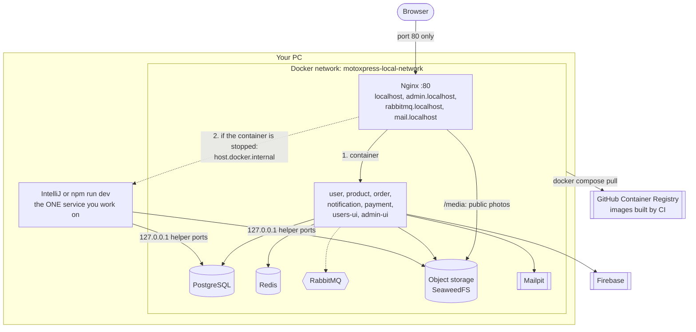

# Local environment (C4 deployment diagram)

`infrastructure/environments/local/` runs the **whole system** on your PC: helpers and every
service, from the images CI built, in one Docker network (`motoxpress-local-network`).
Only Nginx serves the browser. To work on one service, stop its container and run it in IntelliJ
(or `npm run dev`); Nginx finds your copy by itself.

## Ports on your PC

| Port | What | Why |
|---|---|---|
| **80** | Nginx: all sites | The only port the browser uses |
| 127.0.0.1:5432 | PostgreSQL | For services running in IntelliJ |
| 127.0.0.1:6379 | Redis | " |
| 127.0.0.1:5672 | RabbitMQ | " |
| 127.0.0.1:8333 | Object storage (S3 API) | " |
| 127.0.0.1:1025 | Mailpit SMTP | " |

`127.0.0.1` means "this PC only": other computers on your network cannot reach these ports.
The services' own ports (8080–8084) are **not** published; the browser reaches them through Nginx.

| Address | Page |
|---|---|
| http://localhost | Customer site |
| http://admin.localhost | Admin site |
| http://rabbitmq.localhost | RabbitMQ UI (login from `env/rabbitmq.env`) |
| http://mail.localhost | Mailpit inbox |
| http://localhost/media/products/&lt;key&gt; | A product photo |
| http://localhost/media/avatars/&lt;key&gt; | A profile picture |

## Working on one service

| You want | Do |
|---|---|
| Everything from the CI images | `docker compose up -d` |
| Debug order-service | `docker compose stop order-service`, run it in IntelliJ on port 8082 |
| Change the customer UI | `docker compose stop users-ui`, `npm run dev` in users-ui |
| Back to the image | Stop your copy, `docker compose start order-service` |

Your IntelliJ copy reaches the **helpers** on `localhost`. It cannot reach another **service's
container**, because service ports are not published. Example: order-service in IntelliJ calls
product-service; then run product-service in IntelliJ too, or temporarily add a port to product-service.

## Object storage

| Bucket | Holds | Who can read |
|---|---|---|
| `product-media` | Product photos and other public product files | Anyone, through `/media/products/<key>` (read-only) |
| `user-avatars` | Profile pictures | Anyone, through `/media/avatars/<key>` (read-only) |
| `courier-receipts` | Courier receipt PDFs and photos | Only payment-service |
| `shipment-documents` | Pickup-receipt photos | Only order-service |

On every start, `object-storage/start.sh` starts SeaweedFS, creates the buckets in `buckets.conf` that
do not exist yet, and sets up one S3 user per service from `users.conf` (keys from `env/object-storage.env`).
Each service may only use its own bucket. The container reports healthy when this is done, and the
services that store files wait for that.
Services save only the object **key** in their database and send `MEDIA_BASE_URL + key` to the browser.

## Files in `environments/local/`

| File | Holds |
|---|---|
| `docker-compose.yml` | Helpers + every service. Service image tags are written by CI. |
| `nginx/default.conf` | The sites; the UI falls back to Vite (3000, 3001) |
| `nginx/api-routes.inc` | API routes with the IntelliJ fallback |
| `nginx/media.inc` | `/media/products/` and `/media/avatars/` → the two public buckets, read-only |
| `object-storage/start.sh`, `buckets.conf`, `users.conf` | Start SeaweedFS; create buckets and per-service users |
| `postgres/init/01-create-databases.sql` | 5 databases, 5 DB users (runs only on an empty volume) |
| `env/*.env` | One settings file per container and the object-storage keys. In git, with local-only values (M37). |
| `env/user-service.secrets.env`, `env/firebase.json` | The only real secrets (Google, Gmail, Firebase). Ignored by git; you create them. |

Step-by-step commands: `infrastructure/README.md`.
