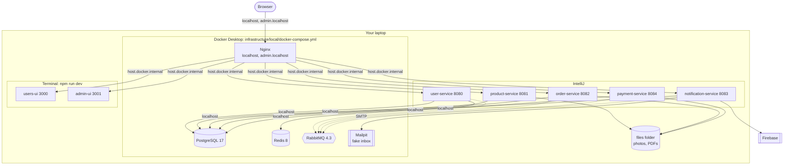

# Local deployment (C4 deployment diagram) — the laptop

The laptop is the first half of the **development environment**. The second half is the
[dev cloud](12-dev-cloud.md). Both run the same code (M11).

## Two directions, two addresses

| From | To | Address | Why |
|---|---|---|---|
| Nginx (in Docker) | a service on the laptop | `host.docker.internal:PORT` | Inside a container, `localhost` is the container itself |
| A service on the laptop | PostgreSQL, Redis, RabbitMQ, Mailpit | `localhost:PORT` | Docker publishes those ports on the laptop |

## `admin.localhost`

Browsers send every `*.localhost` name to your own computer, so `http://admin.localhost` works
without setup. Nginx tells the two sites apart by the host name (`server_name`).
If a command-line tool cannot find `admin.localhost`, add `127.0.0.1 admin.localhost` to the
Windows hosts file. If Vite answers "Blocked request", check `server.allowedHosts` in the Vite docs.

## Start order

1. Start Docker Desktop.
2. `cd infrastructure/local` and `docker compose up -d`. Wait until `docker compose ps` shows healthy.
3. Start the five services in IntelliJ (any order).
4. `npm run dev` in `users-ui` and `admin-ui`.
5. Open `http://localhost` (customer) or `http://admin.localhost` (admin).

A service that is not running only gives `502 Bad Gateway` for its paths.

## Each service's own `.env`

| Service | Needs |
|---|---|
| All Java services | DB URL, DB user and password (from `infrastructure/local/.env`), RabbitMQ user and password, JWT public key, file folder |
| user-service | also Redis, JWT **private** key, Google, Turnstile, bootstrap admin email |
| notification-service | also SMTP host and port (Mailpit), Firebase service-account key |
| users-ui | Turnstile site key, Firebase web config (public values) |

## What `infrastructure/local` must change for the MVP

| File | Change |
|---|---|
| `docker-compose.yml` | Add Mailpit. Check its image tag and ports on its official page. |
| `postgres/init/01-create-databases.sh` | Add `payment_db` / `payment_service`. Remove `suggestion_db`. |
| `nginx/default.conf` | Two `server` blocks on port 80: `localhost` → users-ui, `admin.localhost` → admin-ui. Add `/api/v1/notification/` and `/api/v1/payment/`. Remove `/api/v1/suggestion/` and the port 8000 block. |
| `.env.example` | Add `PAYMENT_DB_PASSWORD`, remove `SUGGESTION_DB_PASSWORD`. |
