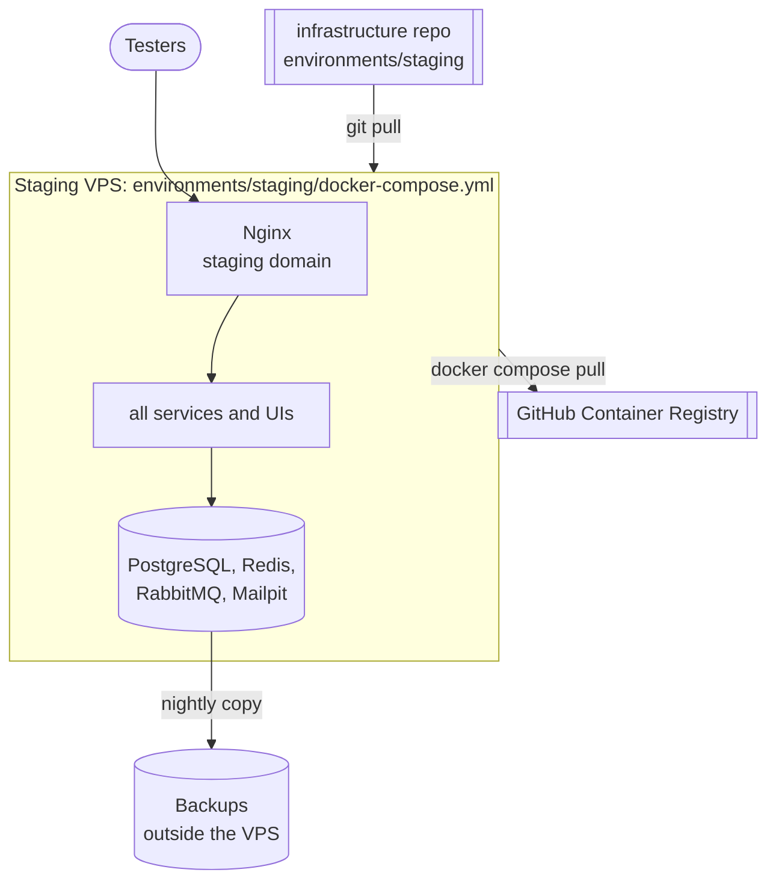

# Environments

Each environment is one folder in `infrastructure/environments/`, with a complete
`docker-compose.yml` (helpers + every service) and its own Nginx config, Postgres init and an `env/` folder (one env file per container).

| Environment | Folder | Where | Gets a new image tag when | Status |
|---|---|---|---|---|
| **local** | `environments/local/` | Your PC | A service is pushed to `main` (automatic) | Active |
| **staging** | `environments/staging/` | A VPS | You press "Run workflow" (promote) in that service's repo | Later: no server yet |
| production | `environments/production/` | A VPS | Promote from staging, with approval | Later |

Every environment runs the **same images**. Only the tags and the secrets differ (M11).

## local vs staging

| | local | staging |
|---|---|---|
| Nginx | Container first, IntelliJ fallback | Containers only |
| Host names | `localhost`, `admin.localhost` | the staging domain (TODO) |
| Ports on the machine | Nginx 80; helper ports on `127.0.0.1` for IntelliJ | Only Nginx |
| Object storage | `object-storage` container (SeaweedFS) creates its own buckets; public files at `/media/products/`, `/media/avatars/` | the same |
| HTTPS | No | TODO: Nginx + Certbot when the VPS exists |
| Email | Mailpit | Mailpit (testers never email real people) |
| Started by | You: `docker compose up -d` | TODO: a deploy step on the VPS |

## Staging later: one VPS



To do when the VPS exists:

1. Install Docker; create a `deploy` user; firewall: only ports 22, 80, 443.
2. Clone the infrastructure repo; create the `env/*.env` files from their `*.env.example` templates.
3. Point DNS at the VPS; put the real domain in `env/user-service.env` and `nginx/default.conf`; add HTTPS.
4. Start: `cd environments/staging && docker compose pull && docker compose up -d`.
5. Automate: a job in the infrastructure repo that SSHes in and runs step 4 after each tag change.
6. Nightly backup of the databases and file volumes, copied off the server.

Size estimate, check with your provider: 4 GB RAM minimum, 8 GB comfortable.

## Promotion

```
push to main ──► environments/local tag ──(Run workflow: promote)──► environments/staging tag ──► production (later)
```

Rollback = put the previous tag back (run the promote workflow with the older commit id).
