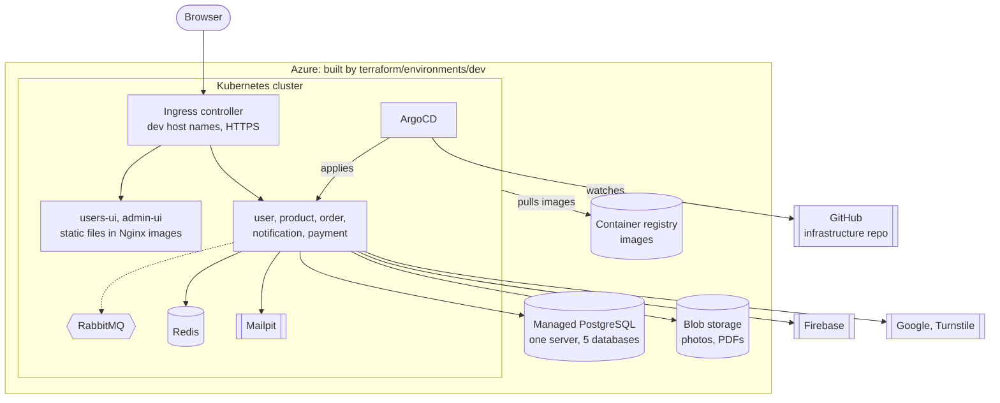

# Dev cloud (C4 deployment diagram) — **Draft**

The second half of the **development environment**: the same images, running on Azure,
deployed by ArgoCD. Staging and production are added later the same way, with their own
overlay, Terraform folder, databases and secrets (M11).

Status: **Draft.** Decision 14 says: practise Kubernetes on a local cluster (kind or minikube)
first, because a cloud cluster costs money every hour. Build this after the MVP runs on the laptop.

## Parts and choices

| Part | Proposal | Status |
|---|---|---|
| Kubernetes cluster | Azure's managed Kubernetes service, smallest size | Draft |
| Ingress | An Ingress controller, the cloud version of our Nginx. Same routes as the laptop. | Draft |
| HTTPS certificates | TODO: choose the tool | Open |
| Host names | Example: `dev.<domain>` and `admin.dev.<domain>` | Open (no domain yet) |
| PostgreSQL | Azure's managed PostgreSQL; one server with 5 databases and 5 DB users (decision 6) | Draft |
| RabbitMQ, Redis, Mailpit | Run inside the cluster: cheap, and no real emails in dev | Draft |
| Files | Azure blob storage, behind the same `FileStorage` interface (M18) | Draft |
| Images | Azure container registry | Draft |
| Secrets | TODO: choose how secrets reach the cluster. Never in git. | Open |
| UIs | `npm run build`, then the static files are served by a small Nginx image | Draft |

## Folders in this repo

| Folder | Holds |
|---|---|
| `terraform/modules/` | Reusable pieces (cluster, database, storage, registry) |
| `terraform/environments/dev/` | The dev cloud. Later also `staging/`, `prod/`. |
| `k8s/platform/` | Shared tools in the cluster: ingress, RabbitMQ, Redis, Mailpit |
| `k8s/apps/<service>/base/` | Deployment, service, health checks; the same for every environment |
| `k8s/apps/<service>/overlays/dev/` | Dev only: image tag, host names, replica count, config |
| `k8s/argocd/` | ArgoCD applications that point at the overlays |

MVP services in `k8s/apps/`: user, product, order, notification, payment, users-ui, admin-ui.
