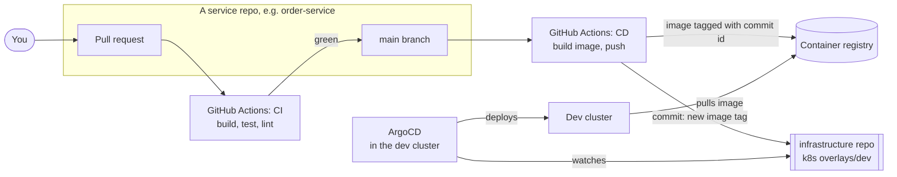

# CI/CD

**CI** (continuous integration) = every change is built and tested automatically.
**CD** (continuous delivery) = every good change on `main` is deployed automatically.
Here CD uses **GitOps**: git holds the truth about what runs, and ArgoCD makes the cluster match it (decision 10).

## The steps

| # | Where | What happens |
|---|---|---|
| 1 | Service repo | You open a pull request |
| 2 | CI workflow | Java: `./mvnw verify` (compile + tests). UI: `npm ci`, lint, `tsc`, build. A red result blocks the merge. |
| 3 | Service repo | You merge to `main` |
| 4 | CD workflow | Build the Docker image, tag it with the **git commit id** (never `latest`), push it to the registry |
| 5 | CD workflow | Change the image tag in `infrastructure/k8s/apps/<service>/overlays/dev/` and commit |
| 6 | ArgoCD | Sees the new commit and updates the dev cluster |
| 7 | Later: staging, prod | Copy the **same** tag into the staging or prod overlay. The image is built once and promoted (M11). |

## Workflows per repo

| Repo | CI | CD |
|---|---|---|
| user, product, order, notification, payment service | build + test | image + update dev overlay |
| users-ui, admin-ui | lint + type check + build | image + update dev overlay |
| infrastructure | check that every overlay builds; Terraform format, validate, plan | ArgoCD applies `k8s/` itself; Terraform apply stays manual at first |

## Rules

| Rule | Why |
|---|---|
| Secrets live in GitHub Actions secrets and the cluster's secret store, never in a workflow file | The repos are public |
| One image per commit, tagged with the commit id | You always know what code runs |
| Tests must pass before merge | `main` is always deployable |
| Database changes only through Flyway | The same SQL runs on the laptop, in dev, and later in prod |

Open: which registry login the workflows use, and how the CD job is allowed to commit to the
infrastructure repo. Decide when you build the first pipeline.
