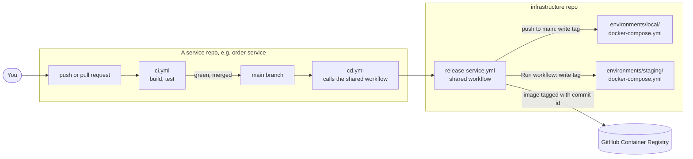

# CI/CD

**CI** (continuous integration) = every change is built and tested automatically.
**CD** (continuous delivery) = every good change on `main` becomes an image, and its tag is written
into an environment's `docker-compose.yml` in the infrastructure repo (M28).



## What happens

| # | Trigger | Where | What |
|---|---|---|---|
| 1 | Any push or pull request | service `ci.yml` | Java: `./mvnw verify`. UI: `npm ci`, lint, `tsc`, build. Red blocks the merge. |
| 2 | Push to `main` | service `cd.yml` → `release-service.yml` | Build the image `ghcr.io/motoxpress-wicky/<service>:<commit id>`, push it |
| 3 | (same run) | `release-service.yml` | Replace that service's `image:` line in `environments/local/docker-compose.yml`, commit to the infrastructure repo |
| 4 | That commit | infrastructure `check-compose.yml` | Checks that both compose files are still valid |
| 5 | You | your PC | `git pull`, `docker compose pull && docker compose up -d` in `environments/local` |
| 6 | You press **Run workflow** on the service's CD | `release-service.yml` with `build: false` | Write an existing tag into `environments/staging/docker-compose.yml` (no new build: the image that worked locally is reused) |

Only `main` builds images (M32). Branches only run CI.

## Files

| Repo | File | Status |
|---|---|---|
| infrastructure | `.github/workflows/release-service.yml` (shared) | Written |
| infrastructure | `.github/workflows/check-compose.yml` | Written |
| each service and UI | `Dockerfile` | To write when you build the service |
| each service and UI | `.github/workflows/ci.yml` | To write (Java or Node version) |
| each service and UI | `.github/workflows/cd.yml` | To write: the file below, with the service name changed |

## `cd.yml` for a service repo

The same file in every repo. Change only `service:` (it must match the compose service name).

```yaml
name: CD

on:
  push:
    branches: [main]
  workflow_dispatch:            # the "Run workflow" button = promote to staging
    inputs:
      tag:
        description: "Commit id to put on staging (empty = the newest commit on main)"
        required: false

jobs:
  local:
    if: github.event_name == 'push'
    permissions:
      contents: read
      packages: write
    uses: MotoXpress-wicky/infrastructure/.github/workflows/release-service.yml@main
    with:
      service: order-service
      environment: local
      build: true
    secrets:
      INFRA_REPO_TOKEN: ${{ secrets.INFRA_REPO_TOKEN }}

  staging:
    if: github.event_name == 'workflow_dispatch'
    permissions:
      contents: read
      packages: write          # GitHub checks this even though the build job is skipped here
    uses: MotoXpress-wicky/infrastructure/.github/workflows/release-service.yml@main
    with:
      service: order-service
      environment: staging
      build: false
      tag: ${{ inputs.tag || github.sha }}
    secrets:
      INFRA_REPO_TOKEN: ${{ secrets.INFRA_REPO_TOKEN }}
```

| Repo | `service:` |
|---|---|
| user-service | `user-service` |
| product-service | `product-service` |
| order-service | `order-service` |
| notification-service | `notification-service` |
| payment-service | `payment-service` |
| users-ui | `users-ui` |
| admin-ui | `admin-ui` |

## Secrets

| Secret | Where | Used for |
|---|---|---|
| `GITHUB_TOKEN` | Built into every workflow | Push images to GHCR |
| `INFRA_REPO_TOKEN` | Each service repo (Settings → Secrets → Actions) | Commit tags into the infrastructure repo. Give it write access to **only** that repo. |
| App passwords and keys (staging) | `environments/staging/env/*.env` on the VPS | Never in GitHub, never in git |
| Local passwords and keys | `environments/local/env/*.env` | In git on purpose: they work only on your PC (M37) |
| Real third-party secrets (local) | `environments/local/env/user-service.secrets.env`, `env/firebase.json` | Ignored by git |

Open: which kind of `INFRA_REPO_TOKEN` (fine-grained personal access token, or a GitHub App).
Check the GitHub docs on "fine-grained personal access tokens" when you add the first `cd.yml`.

## Rules

| Rule | Why |
|---|---|
| One image per commit, tagged with the commit id (never `latest`) | You always know which code runs |
| Tests pass before merge | `main` is always releasable |
| Never edit image tags by hand | The pipelines own them; git history shows every release |
| Database changes only through Flyway | The same SQL runs in every environment |
| No secret in any workflow file | The repos are public |
